# Geração de objetos 3D texturizados a partir de imagem — Objetivo 1, Atividades 1, 3 e 4

**Frente:** Realidade Aumentada — Geração 3D (modelos) · **Bolsista:** Eduardo Martins de Carvalho Caixeta ·
**Coordenação:** Prof. Dr. Carlos Galvão Pinheiro Junior · **Execução:** 26/10/2026 ·
**Repositório:** <https://github.com/EduardoCaixeta/cerise-2026-gen3d> (privado)

## 1. Objetivo

O aplicativo CERISE-AR de 2025 capturava fotos de um objeto e as enviava a um servidor Flask que **apenas simulava**
a reconstrução: aguardava 67 s (`time.sleep(67)`) e devolvia um `objeto.glb` fixo, ajustado pelo script
`central_z.py`. As fontes do Hunyuan3D-2 e 2.1 haviam sido baixadas, mas nunca integradas. A meta de 2026 é
substituir a simulação por uma rede neural real de imagem→3D com textura e com desempenho compatível com o uso no
celular. Esta seção cobre: **(A1)** a análise comparativa de redes neurais de geração 3D texturizada — levantamento
da literatura e benchmark prático no DGX Spark do laboratório; **(A3)** a otimização do modelo escolhido, com
relatório de desempenho e definição de três presets medidos; e **(A4)** a validação por testes funcionais
automatizados e análise qualitativa, incluindo casos de falha.

## 2. Ambiente e metodologia

### 2.1 Plataforma

Os experimentos foram executados no NVIDIA DGX Spark do laboratório (GB10 Grace-Blackwell, arquitetura sm_121, CPU
**aarch64** de 20 núcleos, 128 GB de memória unificada CPU+GPU), em contêiner derivado de
`nvcr.io/nvidia/pytorch:26.05-py3` (PyTorch 2.12, CUDA 13.2, Python 3.12). As extensões CUDA/C++ dos modelos
(rasterizador e `differentiable_renderer` do Hunyuan3D, nvdiffrast, torchmcubes e as extensões do Hunyuan3D-2.1)
foram compiladas para `TORCH_CUDA_ARCH_LIST=12.1`. O alocador do PyTorch foi limitado a 24 GB (teto desta frente) e
os pesos foram obtidos apenas dos repositórios oficiais no Hugging Face, num cache compartilhado.

A máquina é de **produção** e foi compartilhada durante todas as medições: até ~03:40 (horário de Brasília) com a
geração de um *dataset* em Gazebo (média de carga da CPU entre 28 e 52), com treinos de outras frentes na mesma GPU
e, a partir de ~04:20, com os serviços de produção (vLLM) religados. Os tempos absolutos são, portanto, **limites
superiores** e dependem da ocupação: a mesma configuração (Hunyuan3D-2 Turbo, 40 mil faces) levou 68,8 s por objeto
(mediana) sob carga plena e 28,7 s com a máquina parcialmente livre. A média de carga (`loadavg`) e o horário de cada
rodada estão registrados nos `summary.json`. Por esse motivo, as comparações de otimização (A3) foram repetidas de
forma **intercalada** — modelos carregados uma única vez e todas as variantes executadas em sequência para cada
objeto —, o que submete todas as variantes às mesmas condições.

### 2.2 Conjunto de avaliação

Foram usados 13 objetos do **Google Scanned Objects** (GSO, coleção *GoogleResearch* no Gazebo Fuel, licença
CC-BY 4.0), que fornecem a malha escaneada de referência com textura: caneca, boneco Android, cavalo, despertador,
tênis, rinoceronte, águia, leão, ônibus de brinquedo, bule, robô Transformers, tartaruga e torre de argolas
(dimensões reais de 6 a 37 cm). Dois objetos inicialmente sorteados foram descartados após inspeção visual (uma
malha rotulada como triceratope que é, na verdade, um boneco Android duplicado, e uma pelúcia escaneada deitada, com
malha ruidosa). Cada malha (Z para cima) foi convertida para Y para cima, normalizada (centro da caixa envolvente na
origem, maior dimensão = 1) e renderizada com um renderizador próprio em nvdiffrast (`benchmark/render.py`,
iluminação lambertiana + ambiente) numa **vista de entrada** de 1024×1024 px com fundo transparente (azimute 30°,
elevação 15°, objeto ocupando 85% do quadro) e em três vistas de referência (azimutes 120°, 210° e 300°).
Para a análise qualitativa foram usadas ainda **seis fotos reais com licença CC0** do Wikimedia Commons (cinco
objetos do acervo aberto do Metropolitan Museum e um pato de borracha fotografado sobre fundo complexo; fontes em
`validation/real/fontes.json`).

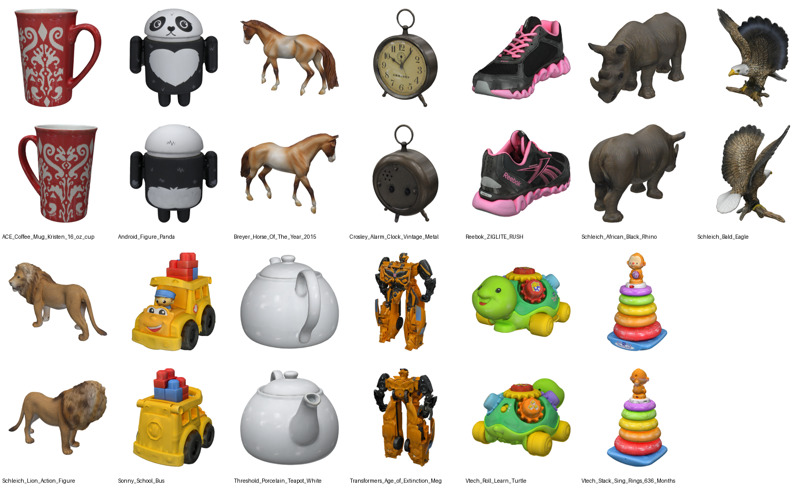

### 2.3 Métricas

* **Geometria.** As malhas gerada e de referência são amostradas em 50 mil pontos de superfície e normalizadas pela
  caixa envolvente (maior dimensão = 1). O alinhamento usa ICP ponto-a-ponto com escala uniforme (Umeyama), iniciado
  em 12 guinadas (passo de 30°) × 2 convenções de eixo (Y-up e Z-up), descartando 10% dos piores pares por
  iteração; fica a solução de menor Chamfer. São reportados o **Chamfer** L2 não quadrático (soma das médias das
  distâncias ao vizinho mais próximo nos dois sentidos) e o **F-score** a τ = 0,05 e 0,1 (média harmônica da
  precisão e da revocação a menos de τ). Um teste de sanidade (`benchmark/selftest_metrics.py`) aplicou rotação,
  escala e translação arbitrárias à própria malha de referência: o procedimento recuperou o alinhamento com
  Chamfer entre 0,0004 e 0,0147 (média 0,0042) e F-score@0,05 ≥ 0,976 nos 13 objetos — esse é o piso de erro de
  amostragem/alinhamento do método.
* **Aparência.** Similaridade de cosseno **CLIP** (ViT-L/14, OpenAI) entre a imagem de entrada e o render do
  resultado alinhado na mesma vista (*CLIP entrada*) e, como medida da coerência das partes que a foto não mostra, a
  média da similaridade entre o render do resultado e o da referência nas três vistas novas (*CLIP vistas novas*).
  Como referência, a própria malha GT **sem textura** obtém CLIP de 0,64 a 0,90 (média 0,76): valores acima disso
  exigem textura plausível.
* **Desempenho.** Tempo total por objeto (mediana) e por etapa, com `torch.cuda.synchronize()` nas fronteiras, em
  **carga quente** (modelos carregados uma vez + uma geração de aquecimento descartada); tempo de carga a frio;
  pico de memória do alocador (`torch.cuda.max_memory_allocated`); faces, vértices e tamanho do GLB; e o tipo de
  aparência gerada (textura UV, cor por vértice ou nenhuma).

## 3. A1 — Análise comparativa de redes neurais para geração 3D texturizada

### 3.1 Levantamento da literatura

A Tabela 1 resume os modelos abertos de imagem→3D com textura considerados. Os valores de VRAM e de velocidade são
os **reportados pelos autores** nos README/artigos, em GPUs de datacenter ("—" = não informado). A última coluna
registra o resultado da tentativa de instalação no GB10 (aarch64 + sm_121 + CUDA 13).

**Tabela 1 — Modelos de geração 3D texturizada a partir de imagem (literatura).**

| Modelo (organização, data) | Licença | Entrada | Saída / textura | Parâmetros | VRAM reportada | Velocidade reportada | Situação no GB10 |
|---|---|---|---|---|---|---|---|
| Hunyuan3D-2.0 (Tencent, jan/2025) | Tencent Hunyuan 3D 2.0 Community (não vale na UE, Reino Unido e Coreia do Sul) | 1 imagem (variante 2mv: multivista) | malha + textura UV RGB (difusão multivista + *bake*), sem PBR | forma 1,1B; Paint 1,3B; Delight 1,3B | 6 GB forma; 16 GB forma+textura | — | **instalado e medido** |
| Hunyuan3D-2mini (Tencent, mar/2025) | idem | 1 imagem | idem (usa o Paint 2.0) | forma 0,6B | — | — | **instalado e medido** (versão turbo) |
| Hunyuan3D-2 Turbo + FlashVDM (Tencent, mar–abr/2025) | idem | 1 imagem | idem; Paint-v2-0-Turbo (destilado) | 1,1B (destilação de passos) | — | artigo FlashVDM: forma em ~1 s em GPU de datacenter | **instalado e medido** |
| Hunyuan3D-2.1 (Tencent, jun/2025) | Tencent Hunyuan 3D 2.1 Community (mesma restrição territorial) | 1 imagem | malha + **PBR** (albedo, metálico, rugosidade) | forma 3,3B; Paint 2B | 10 GB forma; 21 GB textura; 29 GB total | — | **instalado com adaptações** e medido |
| TRELLIS (Microsoft, dez/2024) | MIT | imagem ou texto | Gaussianas 3D, campos de radiância ou malha; GLB texturizado via *bake* | 1,2B (image-large) | ≥ 16 GB | — | **bloqueado** (ver 3.3) |
| TRELLIS.2 (Microsoft, dez/2025) | MIT (dependências com licenças próprias) | 1 imagem | malha O-Voxel com **PBR** | 4B | ≥ 24 GB | ~3 s (512³), ~17 s (1024³), ~60 s (1536³) em H100 | **bloqueado** (ver 3.3) |
| TripoSR (Stability AI + Tripo AI, mar/2024) | MIT | 1 imagem | malha com cor por vértice (*bake* opcional via OpenGL) | — | ~6 GB | < 0,5 s em A100 | **instalado e medido** |
| Stable Fast 3D (Stability AI, ago/2024) | Stability AI Community (gratuita abaixo de US$ 1 mi/ano) | 1 imagem | malha com UV + textura + parâmetros de material | — | ~6 GB | ~0,5 s | **bloqueado** (repositório *gated*) |
| SPAR3D (Stability AI, jan/2025) | Stability AI Community | 1 imagem | nuvem de pontos editável + malha texturizada | — | — | < 1 s | **bloqueado** (repositório *gated*) |
| InstantMesh (TencentARC, abr/2024) | Apache-2.0 | 1 imagem | malha (FlexiCubes) com cor por vértice ou mapa de textura | Zero123++ v1.2 + LRM esparso | — | ~10 s | **instalado e medido** |

Três famílias se destacam: (i) **difusão de forma + textura multivista** (Hunyuan3D-2/2.1, TRELLIS), de maior
qualidade e custo; (ii) **reconstrutores *feed-forward* do tipo LRM** (TripoSR, SF3D, SPAR3D), muito rápidos, mas
com textura limitada (cor por vértice no TripoSR); e (iii) **multivista + LRM** (InstantMesh), intermediários. O app
precisa de um GLB com textura UV de boa qualidade em tempo da ordem de dezenas de segundos, servido por uma máquina
do laboratório.

### 3.2 Benchmark prático no DGX Spark

Foram instalados e medidos seis modelos/variantes que rodam em aarch64: **TripoSR**, **InstantMesh**,
**Hunyuan3D-2mini-Turbo** e **Hunyuan3D-2-Turbo** (ambos com FlashVDM e Paint-v2-0-Turbo), **Hunyuan3D-2.0** na
configuração padrão do repositório (50 passos, octree 384, Paint-v2-0 completo) e **Hunyuan3D-2.1** (forma 3,3B +
textura PBR). Executar o Hunyuan3D-2.1 em aarch64 exigiu adaptações (`models/hy21.py`): o repositório converte
OBJ→GLB com o Blender (`bpy`), que não tem *wheel* para Linux aarch64 — o GLB PBR (albedo + metálico/rugosidade)
passou a ser escrito com trimesh —, e o `custom_rasterizer` do 2.1 foi compilado no próprio diretório, para não
conflitar com o do 2.0. Os pesos do Paint-v2-0 exigiram ajustes de carga (o carregador oficial só aceita `.bin`; o
`.safetensors` do turbo contém chaves de IP-Adapter incompatíveis), resolvidos em `models/make_local_tree.py` e
`models/fix_turbo_unet.py`. Por serem lentos na máquina compartilhada (~4 min por objeto), o Hunyuan3D-2.0 padrão e
o 2.1 foram medidos em subconjuntos de 4 e 2 objetos; os demais, nos 13.

**Tabela 2 — Benchmark A1 no GB10 (carga quente; tempo = mediana por objeto; horário de Brasília).**

| Modelo | Aparência | Objetos | Tempo (s) | Carga a frio (s) | Pico GPU (GB) | Faces (med.) | GLB (MB) | Chamfer ↓ | F@0,05 ↑ | F@0,1 ↑ | CLIP entrada ↑ | CLIP vistas novas ↑ | Condição da máquina |
|---|---|---|---|---|---|---|---|---|---|---|---|---|---|
| TripoSR | cor por vértice | 13 | 0,9 | 7 | 4,2 | 115 567 | 2,3 | 0,042 | 0,904 | 0,977 | 0,849 | 0,809 | 02:10, carga ≈ 38 |
| InstantMesh | cor por vértice | 13 | 16,5 | 22 | 23,2 | 72 256 | 1,4 | 0,046 | 0,893 | 0,963 | 0,844 | 0,836 | 06:50, carga ≈ 2, vLLM ativo |
| Hunyuan3D-2mini-Turbo | textura UV | 13 | 65,8 | 61 | 13,6 | 40 000 | 3,2 | 0,035 | 0,930 | 0,985 | 0,893 | 0,859 | 02:24, carga ≈ 38 |
| **Hunyuan3D-2-Turbo** | textura UV | 13 | 68,8 | 95 | 14,6 | 40 000 | 3,3 | **0,032** | **0,951** | 0,992 | 0,907 | 0,854 | 02:42, carga ≈ 39 |
| Hunyuan3D-2.0 (padrão) | textura UV | 4 | 229,5 | 51 | 14,5 | 40 000 | 3,5 | 0,039 | 0,918 | 0,980 | **0,933** | **0,884** | 06:03, carga ≈ 4, vLLM ativo |
| Hunyuan3D-2.1 (PBR) | textura UV PBR | 2 | 242,9 | 157 | 13,8 | 40 000 | 5,1 | 0,032 | 0,949 | **0,994** | 0,883 | 0,878 | 06:36, carga ≈ 3, vLLM ativo |

Como os dois modelos mais lentos foram medidos em subconjuntos, a Tabela 3 repete a comparação restrita aos
mesmos objetos.

**Tabela 3 — Comparação no subconjunto comum S4 (águia, ônibus, caneca e tartaruga; o 2.1 só tem ônibus e caneca).**

| Modelo | n | Chamfer ↓ | F@0,05 ↑ | F@0,1 ↑ | CLIP entrada ↑ | CLIP vistas novas ↑ |
|---|---|---|---|---|---|---|
| TripoSR | 4 | 0,051 | 0,877 | 0,975 | 0,844 | 0,778 |
| InstantMesh | 4 | 0,073 | 0,766 | 0,894 | 0,855 | 0,797 |
| Hunyuan3D-2mini-Turbo | 4 | 0,038 | 0,918 | 0,980 | 0,922 | 0,862 |
| Hunyuan3D-2-Turbo | 4 | 0,034 | 0,949 | 0,993 | 0,917 | 0,837 |
| Hunyuan3D-2.0 (padrão) | 4 | 0,039 | 0,918 | 0,980 | 0,933 | 0,884 |
| Hunyuan3D-2.1 (PBR) | 2 | 0,032 | 0,949 | 0,994 | 0,883 | 0,878 |

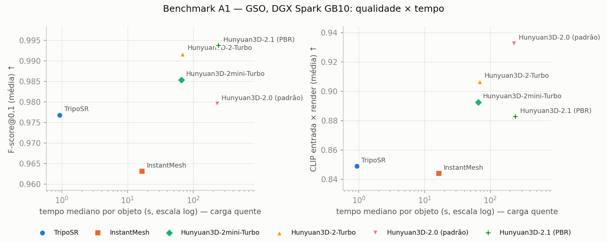

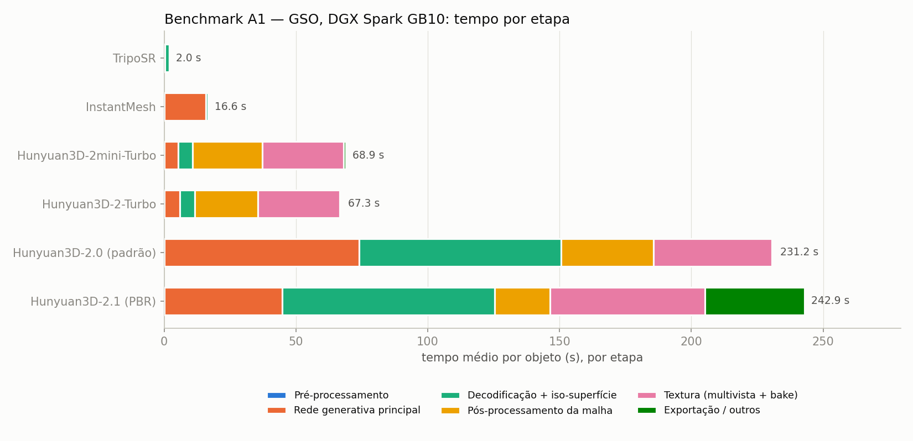

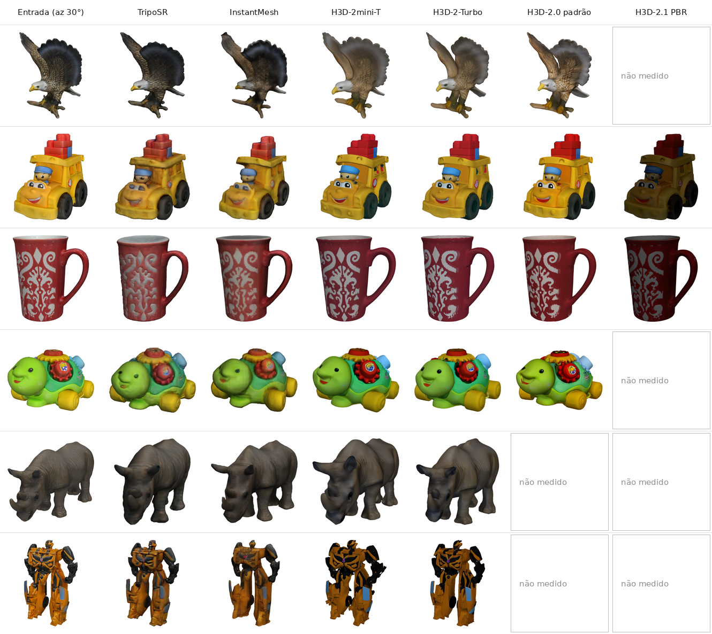

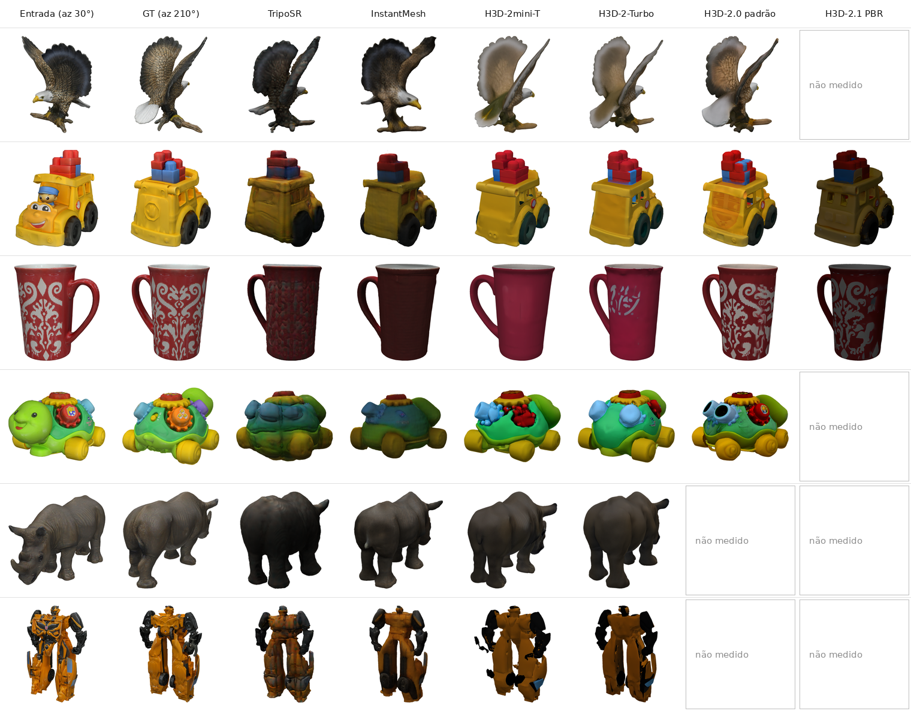

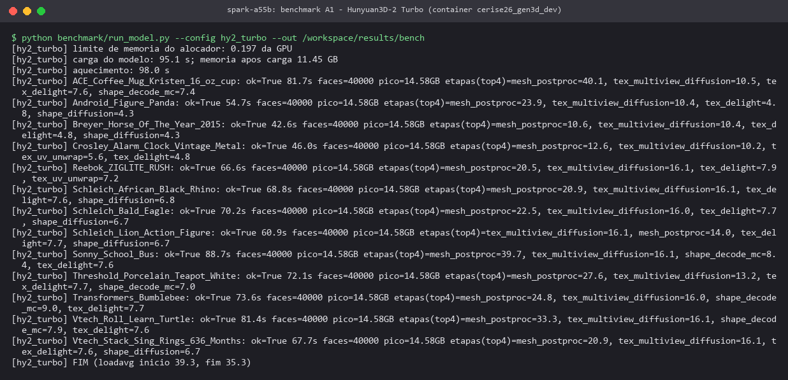

**Análise.** Na geometria, o **Hunyuan3D-2-Turbo** obteve o melhor resultado nos 13 objetos (Chamfer 0,032;
F-score@0,05 0,951), empatado com o Hunyuan3D-2.1 nos dois objetos em que este foi medido. O TripoSR é duas ordens de
grandeza mais rápido (0,9 s), mas tem geometria pior (F@0,05 0,904) e, principalmente, aparência limitada: cor por
vértice, com as costas escuras e borradas (Figura 5). O InstantMesh (16,5 s) também gera cor por vértice, alcança
23,2 GB de pico (no limite do teto da frente, por causa da grade do FlexiCubes) e colapsa em estruturas finas —
na águia o F@0,05 cai para 0,42. Na aparência, o Hunyuan3D-2.0 com o Paint completo teve o maior CLIP (0,933 na
entrada e 0,884 nas vistas novas): a difusão multivista não destilada preserva melhor o padrão da textura nas partes
ocultas (caneca na Figura 5). O Hunyuan3D-2.1 gera materiais PBR, mas o renderizador da avaliação usa apenas o albedo
(sem sombreamento PBR), o que escurece o resultado e penaliza seu CLIP — limitação do método de avaliação, não
necessariamente do modelo. A decomposição por etapa (Figura 3) mostra que, nos modelos turbo, a rede de forma
(difusão + decodificação) custa só ~11 s; o tempo restante vai para a limpeza/decimação da malha com pymeshlab e para
a textura — os alvos da otimização (A3). No 2.0 padrão e no 2.1, dominam os 50 passos de difusão (45–74 s) e a
decodificação volumétrica sem FlashVDM (77–80 s).

### 3.3 Modelos que não puderam ser executados (bloqueios concretos)

* **TRELLIS (Microsoft):** as convoluções esparsas dependem de `spconv`/`cumm` (ou `torchsparse`), sem *wheel* para
  linux-aarch64 no PyPI (consulta registrada em `resultados/trellis_bloqueio_pypi.txt`: todas as distribuições de
  `spconv-cu12x 2.3.8` e de `cumm-cu126 0.8.2` são x86_64/win_amd64; `torchsparse` não está no PyPI). A compilação a
  partir do código-fonte para CUDA 13/sm_121 não é suportada oficialmente e, somada aos rasterizadores próprios
  (diff-gaussian-rasterization, diffoctreerast), não coube no tempo disponível. Os pesos
  (`microsoft/TRELLIS-image-large`, MIT) já estão no cache.
* **TRELLIS.2 (Microsoft, 4B):** além das extensões CUDA próprias (o-voxel, CuMesh, FlexGEMM, nvdiffrec), o
  condicionamento usa o DINOv3 (`facebook/dinov3-vitl16-pretrain-lvd1689m`), repositório com acesso restrito
  (*gated*, aprovação manual) — **pendente**: login no Hugging Face e aceite da licença pelo Eduardo.
* **Stable Fast 3D e SPAR3D (Stability AI):** repositórios *gated* (licença Stability AI Community) — **pendente** o
  mesmo passo (login HF + aceite). O código (`third_party/stable-fast-3d`) já está clonado.

### 3.4 Escolha do modelo para o app

Foi escolhido o **Hunyuan3D-2 Turbo** (forma `hunyuan3d-dit-v2-0-turbo` com FlashVDM + textura
`hunyuan3d-paint-v2-0-turbo` e modelo de *delight*), pelos seguintes critérios:

* **qualidade** — melhor geometria medida no conjunto completo (Tabela 2) e textura UV real (requisito para RA com
  boa aparência), superior a TripoSR/InstantMesh em todas as métricas de aparência;
* **tempo** — rede de forma em ~4–7 s (5 passos destilados + FlashVDM); após as otimizações do A3, ~24–30 s por
  objeto de ponta a ponta com a produção ativa na mesma máquina;
* **memória** — pico de 14,5 GB, dentro do teto de 24 GB e compatível com a coexistência com o vLLM de produção;
* **licença** — Tencent Hunyuan 3D 2.0 Community: uso permitido no Brasil (não vale na UE, Reino Unido e Coreia do
  Sul; uso comercial acima de 1 milhão de usuários ativos mensais exige licença própria). Como alternativa de
  licença permissiva, o TripoSR (MIT) fica documentado (prévia em < 1 s, sem textura UV).

O Paint completo foi mantido apenas no preset "alto", e o Hunyuan3D-2.1 (PBR) fica como evolução futura, quando houver
GPU dedicada (~4 min/objeto aqui; 21 GB de VRAM para a textura segundo os autores).

## 4. A3 — Otimização do pipeline escolhido e relatório de desempenho

### 4.1 Variantes avaliadas

Partindo da configuração base (Hunyuan3D-2 Turbo: 5 passos, FlashVDM, octree 384, limpeza e decimação para 40 mil
faces com pymeshlab, textura de 2048 px com Paint-v2-0-Turbo, fp16), cada fator foi alterado isoladamente:
pós-processamento rápido da malha (descarte de componentes com menos de 1% da área do maior + decimação quádrica com
`fast-simplification`, no lugar de `FloaterRemover`/`DegenerateFaceRemover`/`FaceReducer` do pymeshlab), octree 256,
20 mil e 10 mil faces, textura de 1024 px, 10 passos de difusão, Paint completo, forma em bf16 e FlashVDM desligado.
Foram medidas duas séries: uma **intercalada** com 4 objetos (modelos carregados uma vez; para cada objeto, todas as
variantes de parâmetros em sequência — comparação robusta de tempo) e uma **sequencial** com 7 objetos (uma rodada
por variante, incluindo as que exigem outros pesos; tempos mais sujeitos à ocupação da máquina).

**Tabela 4 — A3, série intercalada (4 objetos; mesmas condições para todas as variantes).**

| Variante | Tempo (s) | Razão vs. base | Pós-proc. da malha (s) | Textura (s) | Faces | GLB (MB) | Chamfer ↓ | F@0,05 ↑ | CLIP entrada ↑ | CLIP vistas novas ↑ |
|---|---|---|---|---|---|---|---|---|---|---|
| base (oct 384, 40k, tex 2048, pymeshlab) | 63,9 | 1,00 | 33,1 | 21,7 | 40 000 | 3,7 | 0,034 | 0,949 | 0,917 | 0,837 |
| **pós-processamento rápido** | **37,5** | **0,62** | **6,2** | 22,2 | 39 999 | 3,9 | 0,033 | 0,950 | 0,908 | 0,833 |
| **octree 256** | **41,0** | **0,64** | 13,1 | 21,1 | 40 000 | 3,7 | 0,033 | 0,951 | 0,914 | 0,844 |
| 20 mil faces | 63,8 | 0,99 | 33,3 | 18,7 | 20 000 | 3,2 | 0,034 | 0,948 | 0,915 | 0,843 |
| 10 mil faces | 63,6 | 0,98 | 33,6 | 18,3 | 10 000 | 2,8 | 0,034 | 0,949 | 0,914 | 0,845 |
| textura 1024 px | 63,0 | 0,99 | 33,0 | 20,3 | 40 000 | 1,9 | 0,034 | 0,949 | 0,912 | 0,843 |
| 10 passos (forma) | 67,1 | 1,10 | 32,9 | 21,3 | 40 000 | 3,6 | 0,034 | 0,948 | 0,913 | 0,864 |

**Tabela 5 — A3, série sequencial (7 objetos; inclui variantes com outros pesos).**

| Variante | Tempo (s) | Etapa de forma (s) | Textura (s) | GLB (MB) | Chamfer ↓ | F@0,05 ↑ | CLIP entrada ↑ | CLIP vistas novas ↑ |
|---|---|---|---|---|---|---|---|---|
| base | 28,7 | 3,5 | 12,0 | 3,4 | 0,036 | 0,940 | 0,909 | 0,846 |
| pós-processamento rápido | 16,4 | 3,4 | 11,2 | 3,6 | 0,036 | 0,941 | 0,899 | 0,844 |
| octree 256 | 20,5 | 2,5 | 11,8 | 3,4 | 0,036 | 0,942 | 0,906 | 0,852 |
| 20 mil faces | 26,9 | 3,4 | 9,5 | 2,9 | 0,036 | 0,940 | 0,913 | 0,851 |
| 10 mil faces | 46,1* | 4,1 | 17,1 | 2,6 | 0,036 | 0,940 | 0,911 | 0,853 |
| textura 1024 px | 50,8* | 7,1 | 16,5 | 1,9 | 0,036 | 0,940 | 0,903 | 0,848 |
| **Paint completo (não destilado)** | 85,4 | 8,5 | **51,7** | 3,5 | 0,036 | 0,940 | **0,921** | **0,893** |
| 10 passos | 34,1 | 6,4 | 13,4 | 3,4 | 0,036 | 0,939 | 0,911 | 0,864 |
| forma em bf16 | 47,5* | — | — | 3,3 | 0,035 | 0,940 | 0,903 | 0,855 |
| **sem FlashVDM** (3 objetos) | 159,4 | **115,7** | 22,0 | 3,1 | 0,037 | 0,933 | 0,914 | 0,874 |

\* rodadas afetadas por ocupação da GPU por outras frentes (a etapa de forma, idêntica entre essas variantes, dobrou
de tempo); a comparação de tempo confiável dessas variantes é a da Tabela 4.

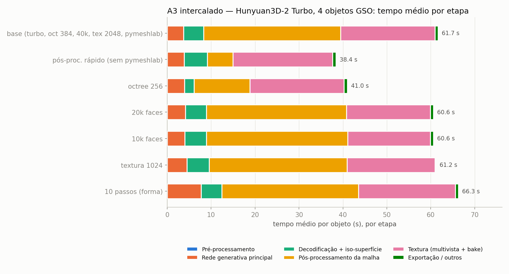

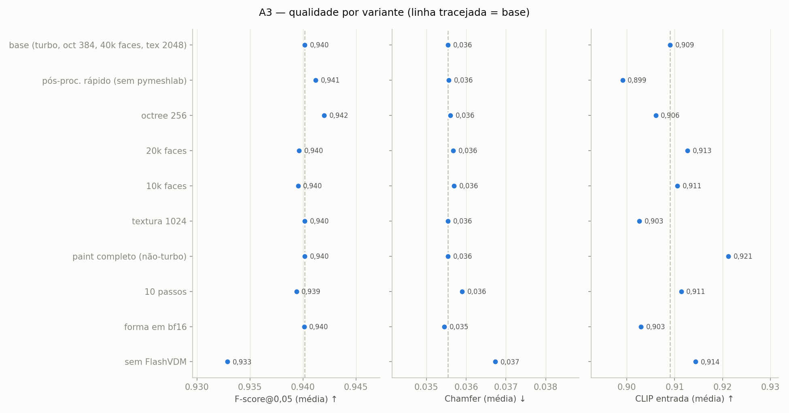

**Análise.**

* **FlashVDM** é indispensável: sem ele a etapa de forma passa de 3,5 s para 115,7 s (≈ 33×), sem ganho de
  geometria (F@0,05 0,933 contra 0,940).
* O **pós-processamento rápido** é a maior economia de tempo de ponta a ponta: reduz o pós-processamento da malha de
  33,1 s para 6,2 s e o total em ~40% (razão mediana por objeto de 0,62 na série intercalada e 0,55 na
  sequencial), com geometria igual (Chamfer
  0,034 → 0,033; F@0,05 0,949 → 0,950) e CLIP de entrada 0,009 menor.
* **Octree 256** reduz o total em 36% (malha bruta menor acelera a decodificação e a limpeza) sem perda mensurável
  (F@0,05 0,951; CLIP 0,914).
* **Orçamento de faces** (20k/10k) e **textura 1024 px** quase não mudam o tempo total, mas reduzem o GLB
  (3,7 → 3,2 → 2,8 MB e 3,7 → 1,9 MB, respectivamente) sem perda geométrica; o CLIP varia dentro do ruído
  (± 0,005).
* **10 passos** custam +10% de tempo sem ganho geométrico; melhoram um pouco o CLIP das vistas novas (+0,027).
* O **Paint completo** quadruplica o custo da textura (12,0 → 51,7 s), mas é a única variante que melhora claramente
  a aparência das partes ocultas (CLIP vistas novas 0,846 → 0,893) — foi reservado ao preset "alto".
* **bf16** funcionou após uma correção (o *marching cubes* do hy3dgen converte a grade para NumPy, que não tem
  bfloat16; `models/hy2.py` faz o *cast* para float32), com qualidade equivalente e sem ganho de tempo — o fp16
  foi mantido.
* **Carga quente × fria:** carregar o pipeline leva 107–115 s e a primeira geração (aquecimento) 79–118 s, contra
  24–30 s por geração em regime — o servidor precisa manter os modelos residentes (carga única).
* **Remoção de fundo** (rembg/U²-Net em CPU): 0,4 a 1,6 s nas fotos reais; zero nas imagens RGBA.
* **torch.compile** não foi avaliado: após as otimizações, o tempo restante concentra-se na difusão multivista da
  textura (~9 s) e no *delight* (~4 s), e a compilação do DiT com formas dinâmicas não cabia no tempo disponível;
  fica como próximo passo.

### 4.2 Presets do app

Com base no A3, foram definidos três presets sobre **um único modelo de forma** (Hunyuan3D-2 Turbo + FlashVDM, 5
passos) e com o pós-processamento rápido, o que permite a carga quente única no servidor (`pipeline/presets.json`):

* **rápido** — octree 256, 10 mil faces, textura assada em 1024 px, Paint-v2-0-Turbo;
* **padrão** — octree 384, 20 mil faces, textura assada em 2048 px e entregue em 1024 px, Paint-v2-0-Turbo;
* **alto** — octree 384, 40 mil faces, textura de 2048 px, **Paint-v2-0 completo**.

Os presets foram medidos com o próprio pipeline empacotado (`benchmark/run_presets.py`), de ponta a ponta — remoção
de fundo, geração, pós-processamento para o celular e miniatura —, nos 13 objetos GSO e nas 6 fotos reais, com os
serviços de produção ativos na mesma máquina.

**Tabela 6 — Presets medidos no pipeline empacotado (carga quente; tempos e tamanhos sobre as 19 entradas,
qualidade sobre os 13 objetos GSO).**

| Preset | Tempo mediano GSO (s) | Tempo mediano fotos reais (s) | Faixa (s) | Faces | GLB final (MB, mediana) | Faixa GLB (MB) | Pico GPU (GB) | Chamfer ↓ | F@0,05 ↑ | CLIP entrada ↑ | CLIP vistas novas ↑ |
|---|---|---|---|---|---|---|---|---|---|---|---|
| **rápido** | 23,9 | 24,0 | 21,9–27,3 | 10 000 | 1,65 | 0,97–2,60 | 14,5 | 0,032 | 0,951 | 0,890 | 0,840 |
| **padrão** | 30,4 | 29,8 | 26,8–76,6 | 20 000 | 2,01 | 1,17–2,97 | 14,5 | 0,032 | 0,951 | 0,894 | 0,851 |
| **alto** | 82,1 | 56,7 | 53,5–104,5 | 40 000 | 6,14 | 3,90–9,51 | 14,5 | 0,032 | 0,951 | 0,922 | 0,876 |

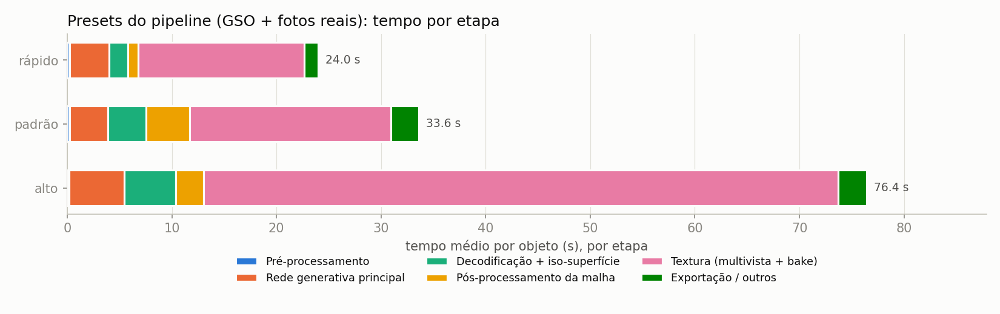

A carga a frio do pipeline (forma + textura turbo, 11,4 GB alocados) levou 115 s e o aquecimento 79 s; para o
"alto", 107 s + 118 s. A diferença de tempo do "alto" entre GSO e fotos reais reflete a variação de ocupação da GPU
durante a rodada.

### 4.3 Pós-processamento para o celular

O GLB gerado passa por `pipeline/postprocess.py`:

1. **assentar e centralizar** — reaproveita a ideia do `central_z.py` de 2025, corrigindo-o (o script antigo
   deslocava o eixo Z pelo centro do eixo Y): centraliza em X e Z e coloca o ponto mais baixo em y = 0 (glTF é
   Y-para-cima; a frente do objeto fica voltada para +Z, direção da câmera padrão do `<model-viewer>`);
2. **escala métrica** — maior dimensão = 0,30 m;
3. **redução de textura** — glTF-Transform redimensiona e recodifica a textura em JPEG (1024 px nos presets rápido e
   padrão; 2048 px no alto). Por requisito do app — o `<model-viewer>` embutido funciona *offline* e o ViroReact não
   tem decodificadores —, o GLB entregue **não usa Draco, meshopt nem KTX2**; o tamanho é controlado pela decimação e
   pela textura;
4. **validação** com o Khronos glTF-Validator e **miniatura** PNG para a interface.

Para quantificar o que se deixa de ganhar sem compressão geométrica, as estratégias foram comparadas nos 19 GLBs do
preset padrão (Figura 10): textura JPEG de 2048 px resulta em 4,95 MB (mediana); **JPEG 1024 px, usado no app, em
2,01 MB**; JPEG 512 px em 0,97 MB; Draco + JPEG 1024 em 1,58 MB e meshopt + JPEG 1024 em 1,64 MB — a compressão
geométrica economizaria só ~21%, porque a textura domina o tamanho.

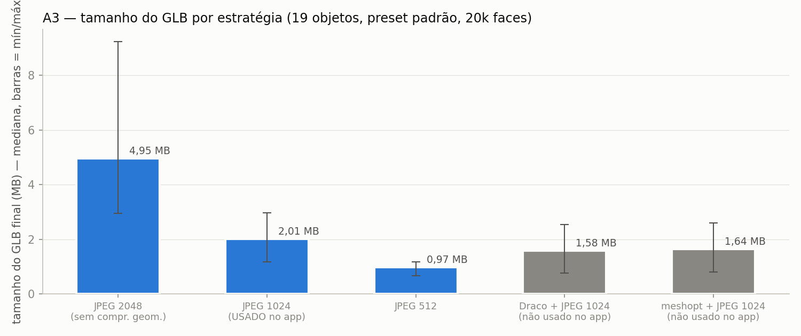

> **Errata (26/10, constatada no teste ponta a ponta do servidor).** A recodificação "em JPEG" acima **não ocorreu**:
> o `postprocess.compress` chamava `gltf-transform jpeg` sem `--formats`, e na glTF-Transform 4.5 o padrão é
> `--formats jpeg` (só recomprime texturas que já são JPEG). Os GLBs desta seção — inclusive os da Figura 10 e os
> tamanhos dos presets — têm textura **PNG** redimensionada (conferido em `server/resultados/e2e/glb_check_presets_anteriores.txt`:
> rooster rápido/padrão/alto com PNG 1024/1024/2048). As conclusões qualitativas e de geometria não mudam; os
> tamanhos estão superestimados. Com a correção (`--formats "*"`, já ativa no servidor), a mesma foto no preset
> padrão passa de 2,97 MB para 0,72 MB e no rápido de 2,60 MB para 0,44 MB; a figura e a tabela de presets devem
> ser refeitas numa próxima rodada.

### 4.4 Empacotamento para o servidor

O pipeline foi empacotado como a classe `Gen3DPipeline` (`pipeline/gen3d_pipeline.py`), com carga quente única no
construtor e o método `generate(image_path, out_dir, preset) → {glb_path, thumb_path, stats}`, em que `stats` traz
os tempos por etapa, faces, tamanho do GLB, caixa envolvente, extensões glTF usadas e pico de memória. A imagem
Docker **`cerise26_gen3d:latest`** (38 GB, construída a partir de `docker/Dockerfile`, `FROM
nvcr.io/nvidia/pytorch:26.05-py3`, com as extensões compiladas para sm_121, Node 22 e as ferramentas glTF) contém o
código; os pesos ficam no cache HF compartilhado, montado como volume. O arquivo `~/cerise2026/gen3d/READY.json`
(cópia em `resultados/READY.json`) registra a imagem, o caminho do módulo, os presets com tempos medidos, a memória
e a forma de instanciar, para a etapa seguinte (servidor HTTP, pasta `server/` deste repositório).

## 5. A4 — Validação

### 5.1 Testes funcionais automatizados (pytest)

A suíte `validation/test_pipeline.py` exercita o pipeline empacotado — a mesma classe usada pelo servidor — com três
entradas (duas imagens RGBA do GSO e uma foto real com fundo, que força a remoção de fundo) em cada preset e
verifica, para cada GLB final: validade segundo o **Khronos glTF-Validator** (zero erros); material PBR com
`baseColorTexture`; **ausência de Draco/meshopt/KTX2** e texturas JPEG/PNG (requisito do app); orçamento de faces do
preset; caixa envolvente métrica (maior dimensão = 0,30 m, base em y = 0, centrado em x/z); limites de tempo (60, 90
e 180 s) e de tamanho (3, 4 e 10 MB) dos presets rápido, padrão e alto; e a miniatura. Há também testes sem GPU do
assentamento/escala e da redução de textura. Resultado: **58 testes, 58 aprovados** (38 em 3 min 10 s com rápido +
padrão; 20 em 2 min 15 s com o alto; Figura 12). Os limites de tamanho foram calibrados com a rodada de presets da
Tabela 6 (o GLB do "alto" chega a 9,5 MB com textura de 2048 px).

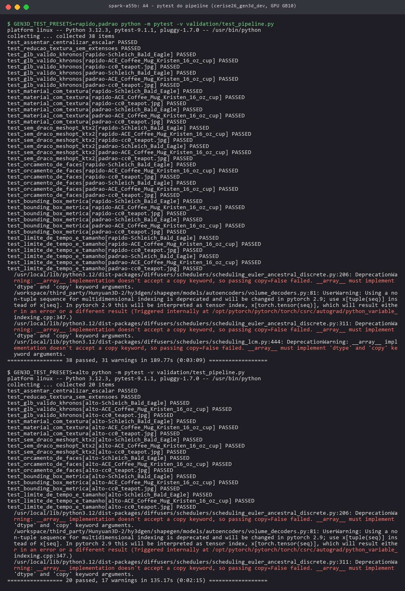

### 5.2 Carregamento no visualizador

Sete GLBs finais (presets padrão, rápido e alto; objetos GSO e fotos reais) foram abertos em Chromium *headless*
(Playwright, WebGL por SwiftShader) numa página com o `<model-viewer>` e, em paralelo, com o `GLTFLoader` do
three.js (`validation/viewer_check.py`). Todos carregaram nos dois visualizadores, sem extensões glTF, com 1 malha,
1 material com mapa de cor, a contagem de triângulos do preset, maior dimensão de 0,30 m e base em y = 0
(`resultados/viewer/viewer_report.json`).

### 5.3 Análise qualitativa

As Figuras 14 e 15 mostram, para oito objetos GSO e para as seis fotos reais (preset padrão), a entrada, os renders
frontal e 3/4 e um *close* da textura. Nas vistas observadas, a textura reproduz detalhes finos (rosto e boné do
motorista do ônibus, cadarços e logotipo do tênis, padrão da caneca); a geometria preserva estruturas finas (pernas
do cavalo, cadarços, asas da águia). Nas fotos reais, a remoção de fundo funcionou inclusive sobre o fundo complexo
(pato sobre grade metálica) e o pipeline recuperou formas plausíveis de objetos fora da distribuição de treino
(figuras de cerâmica antigas).

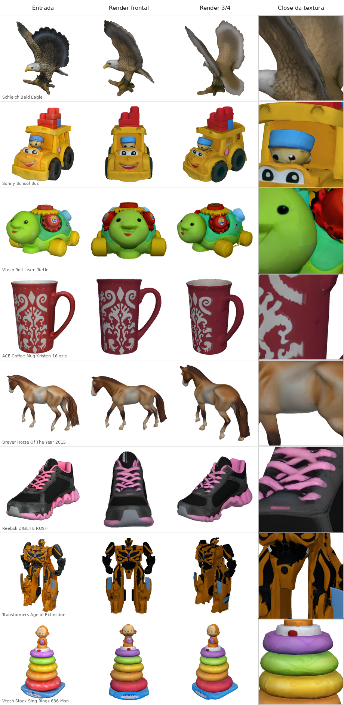

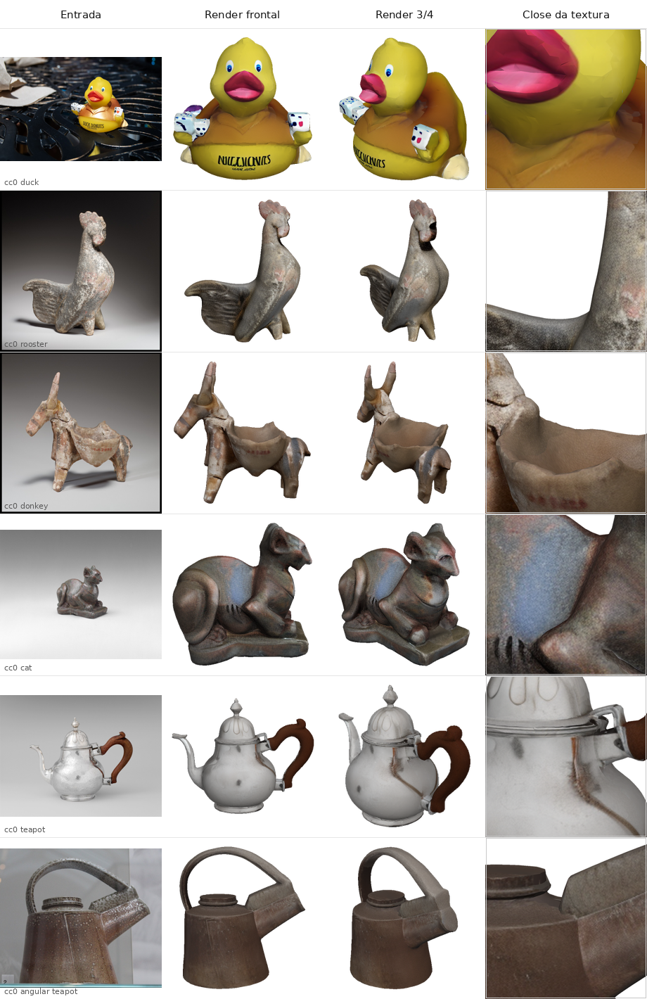

### 5.4 Casos de falha

* **Partes ocultas** — as costas são "inventadas": a textura fica mais lisa e acinzentada (asas da águia), e regiões
  escuras ou finas podem sair pretas ou com buracos (costas do robô Transformers). O Paint completo (preset alto)
  reduz o problema (CLIP vistas novas 0,876 contra 0,851 no padrão).
* **Materiais metálicos/especulares** — no bule de prata, os reflexos e o brilho ficam "assados" no albedo e o
  aspecto metálico se perde (o modelo 2.0 não gera PBR); o 2.1 trataria isso com metálico/rugosidade.
* **Objetos compostos** — no pato, os dados seguros pelas asas saem como peças parcialmente destacadas; a limpeza de
  componentes pequenos pode remover peças legítimas menores que 1% da área.
* **Estruturas finas nos concorrentes** — o InstantMesh colapsa a águia (F@0,05 0,42) e o TripoSR achata o
  rinoceronte (F@0,05 0,74); no Hunyuan3D-2 Turbo o pior caso foi o mesmo rinoceronte (F@0,05 0,88), visto quase de
  frente na entrada.
* **Avaliação** — o CLIP mede a semelhança visual, não a métrica; e o renderizador sem sombreamento PBR subestima o
  Hunyuan3D-2.1.

## 6. Repositório e reprodutibilidade

Código, tabelas e figuras: <https://github.com/EduardoCaixeta/cerise-2026-gen3d> (privado; o histórico está
versionado no espelho local `E:\CERISE\FRENTES\REALIDADE AUMENTADA\GERACAO_3D` e a criação do repositório remoto +
*push* ficou pendente de autorização — ver seção 7). Estrutura: `models/`
(executores instrumentados e preparo dos pesos), `benchmark/` (conjunto GSO, renderizador, métricas, execução,
agregação), `pipeline/` (pacote do servidor, presets, pós-processamento, `write_ready.py`), `validation/` (pytest,
visualizador, grades, fotos CC0), `docker/` (Dockerfile e scripts de instalação), `evidencias/` e `resultados/`
(CSV/JSON/Markdown de todas as medições, logs das rodadas, relatório do pytest e o `READY.json`). Pesos, dados GSO e
GLBs gerados ficam no Spark (`~/cerise2026/hf_cache` e `~/cerise2026/gen3d/{data,results}`).

## 7. Limitações e próximos passos

* **Máquina compartilhada:** os tempos foram medidos com a geração de *dataset*, treinos de outras frentes e a produção
  (vLLM) competindo pela GPU; numa GPU dedicada devem ser menores. Recomenda-se repetir a rodada de presets em janela
  ociosa para fixar os tempos de referência do servidor.
* **Subconjuntos:** Hunyuan3D-2.0 padrão e 2.1 foram medidos em 4 e 2 objetos, por custo de tempo; a comparação
  justa está na Tabela 3.
* **Pendências que dependem do Eduardo:** criar o repositório privado e enviar o histórico local
  (`gh repo create EduardoCaixeta/cerise-2026-gen3d --private --source . --remote origin --push`, na pasta do
  espelho local); login no Hugging Face e
  aceite das licenças de Stable Fast 3D, SPAR3D e DINOv3 (TRELLIS.2) para completar o benchmark; a decisão de expor
  publicamente o servidor 3D (nada do Spark foi exposto à internet).
* **TRELLIS:** compilar `spconv`/`cumm` para aarch64/CUDA 13 (ou portar para `torchsparse`) num trabalho dedicado.
* **Próximos passos técnicos:** usar as várias fotos que o app já captura (variante multivista Hunyuan3D-2mv);
  avaliar o Hunyuan3D-2.1 com renderização PBR na métrica; `torch.compile`/TensorRT na difusão multivista da textura;
  integração com o servidor HTTP (etapa seguinte) e teste no app com fotos do próprio celular.
