# Servidor de geração 3D: arquitetura, gargalos e atendimento a múltiplas requisições — Objetivo 2, Atividade 5 (e lado servidor da Atividade 2 do Objetivo 1)

**Frente:** Realidade Aumentada — Servidor 3D · **Bolsista:** Eduardo Martins de Carvalho Caixeta ·
**Coordenação:** Prof. Dr. Carlos Galvão Pinheiro Junior · **Execução:** 26/10/2026 ·
**Repositório:** <https://github.com/EduardoCaixeta/cerise-2026-gen3d> (privado), pasta `server/`

## 1. Objetivo

O Objetivo 2 do Plano de Trabalho 2026 prevê a "otimização do servidor do aplicativo para o gerenciamento eficiente
de múltiplas solicitações simultâneas de usuários" e a "adequação da arquitetura do sistema para maior escalabilidade
e confiabilidade". A Atividade 5 pede, especificamente, a **análise da arquitetura atual do servidor do aplicativo e
a identificação de gargalos no atendimento a múltiplas requisições**. Esta seção também cobre o **lado servidor da
Atividade 2 do Objetivo 1** (integração do modelo de rede neural selecionado ao aplicativo): o modelo escolhido e
otimizado na seção de geração 3D (Hunyuan3D-2 Turbo, pacote `Gen3DPipeline`) passou a ser servido por uma API HTTP
consumida pelo aplicativo de 2026 e, por compatibilidade, pelo aplicativo Android de 2025.

O trabalho foi organizado em quatro etapas: (i) análise da arquitetura de 2025 e reprodução **medida** dela com o
modelo real; (ii) projeto e implementação de uma arquitetura assíncrona com fila; (iii) testes de carga comparando
as duas arquiteturas e os mecanismos novos (cache, coalescência, prioridade, *backpressure*, dois *slots* de GPU);
(iv) teste ponta a ponta a partir de um computador externo e documentação de operação.

## 2. A arquitetura de 2025 e seus gargalos

O servidor de 2025 (`CERISE-AR/server.py`) é um aplicativo Flask executado com o servidor de desenvolvimento
(`app.run(host='10.1.1.75', port=5000, debug=True)`). A rota `POST /` recebe as fotos (`front`, `left`, `back`,
`right`) e um campo `metadata`, grava as imagens em `uploads/` com o nome enviado pelo cliente, executa
`time.sleep(67)` para **simular** o processamento e devolve sempre o mesmo arquivo `objeto_ajustado.glb`, preparado
na inicialização pelo script `central_z.py` (Figura 1). Da leitura do código identificam-se os seguintes gargalos e
riscos:

1. **Processamento dentro da requisição.** A conexão HTTP fica presa durante toda a "geração"; o app de 2025 usava
   `readTimeout` de 5 min no OkHttp para suportar a espera. Atrás de um *proxy* reverso (tempo limite típico de
   60–100 s) a requisição seria cortada.
2. **Sem fila e sem limite de concorrência.** O servidor de desenvolvimento cria uma *thread* por conexão; com um
   modelo real, N pedidos simultâneos significam N chamadas concorrentes à mesma GPU e aos mesmos objetos do modelo.
3. **Nada persiste.** Não há identificador de pedido, progresso, cancelamento nem retomada; queda ou reinício do
   processo perde todos os pedidos em andamento.
4. **Arquivos com nome fixo.** Entradas em `uploads/<nome do cliente>` e saída única `objeto_ajustado.glb`: pedidos
   simultâneos sobrescreveriam as fotos e o modelo uns dos outros.
5. **Servidor de desenvolvimento com `debug=True`** (console interativo do Werkzeug exposto) e IP fixo de rede local.
6. **Ausência de validação, limites, autenticação, TLS, métricas e logs estruturados.**

Como o `sleep(67)` não exercita a GPU, a arquitetura de 2025 foi **reproduzida com o modelo real**
(`server/baseline_2025/server_2025_real.py`): mesmo Flask *threaded*, mesmo fluxo síncrono, caminho de saída fixo,
sem validação nem fila, mas com o `sleep` substituído pela chamada síncrona ao `Gen3DPipeline` (preset rápido,
modelo carregado uma vez no processo). Foram medidos dois modos: **sem trava** (o que o código de 2025 faria ao
receber o modelo real) e **com trava global** (a correção mínima "óbvia", que serializa a GPU mas mantém as conexões
presas).

## 3. Arquitetura proposta e implementada (2026)

A arquitetura nova separa a recepção dos pedidos do processamento na GPU (Figura 2):

* **API** (`cerise26_gen3d_api`): FastAPI + Uvicorn, assíncrona, nunca toca na GPU. Valida e normaliza a foto
  (tipo, tamanho ≤ 15 MB antes de ler o corpo, proteção contra *decompression bomb*, orientação EXIF aplicada,
  metadados e GPS removidos, lado máximo de 2048 px), decide cache/coalescência/*backpressure*, grava o job no banco e
  responde `202 {job_id, status, position, eta_seconds}` em milissegundos. Expõe `GET /api/v1/jobs/{id}` (estado,
  progresso por etapa, posição e ETA), downloads do `model.glb` e da `thumbnail.png`, `DELETE` (cancela ou apaga os
  dados), `/metrics` (Prometheus), `/docs` (Swagger) e o **endpoint legado `POST /`**, compatível com o app de 2025
  (multipart com `front` + `metadata`; devolve o GLB na resposta, agora gerado de verdade).
* **Fila persistente em SQLite (WAL)**: jobs, workers, contadores e histogramas. O *claim* atômico usa
  `UPDATE … RETURNING` dentro de `BEGIN IMMEDIATE`. A ordem é FIFO com **prioridade por preset e envelhecimento**
  (`score = criado_em + deslocamento`; rápido +0 s, padrão +30 s, alto +90 s), de modo que nenhum job espera mais
  que o deslocamento além do que esperaria numa FIFO pura.
* **Worker de GPU** (`cerise26_gen3d_worker1`, sem rede): carrega o modelo uma única vez (~60–135 s) e aquece os
  presets; processa 1 job por vez (configuração de produção) ou 2 *slots* no mesmo processo com pesos
  compartilhados e travas por componente com estado (difusão de forma + *scheduler*, decodificador FlashVDM,
  *delight*, difusão multivista de cada *paint*, renderizador da miniatura). Envia *heartbeat*, aplica tempo limite
  por preset, devolve à fila o que estava rodando após reinício, trata falta de memória de GPU reenfileirando o job,
  só pega job novo se houver folga de memória no host (≥ 10 GB "available", regra do Spark compartilhado) e pode ser
  pausado sem derrubar a API (`data/PAUSE`).
* **Cache por hash** (SHA-256 da imagem normalizada + opções + versão do pipeline) e **coalescência** de pedidos
  idênticos em andamento.
* **Limites**: fila máxima (padrão 32; 429 com `Retry-After` quando cheia), 4 pedidos em andamento por cliente,
  *rate limit* de envios (6/min) e de leituras (1200/min) por cliente.
* **Retenção de 7 dias** (requisito da política de privacidade do app): a foto é apagada logo após o processamento;
  uma rotina de limpeza apaga jobs, modelos e miniaturas com mais de 7 dias; `DELETE` num job terminado apaga os
  dados na hora; o IP do cliente não é gravado (apenas um *hash* truncado).
* **Implantação**: Docker Compose, imagem `cerise26_gen3d_server:latest` derivada da imagem do pipeline,
  `restart: unless-stopped`, porta publicada **apenas no loopback do Spark** (`127.0.0.1:8095`).

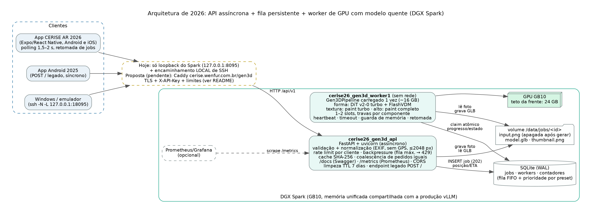

A Figura 3 mostra a documentação OpenAPI gerada pela própria API, com os esquemas de resposta e os códigos de erro
de cada rota.

## 4. Metodologia dos testes de carga

* **Ambiente**: DGX Spark (GB10, 128 GB de memória unificada), **com a produção de IA ativa** (três instâncias vLLM
  e o Qdrant; na verificação final os processos vLLM ocupavam ~38,7 GB de GPU) — os números refletem a máquina
  compartilhada, não uma GPU dedicada. Teto de GPU desta frente: 24 GB.
* **Cliente de carga**: `server/loadtest/loadtest.py` (asyncio + httpx), executado num contêiner no próprio Spark
  contra `127.0.0.1` (latência de rede excluída). Cada cliente simulado usa um `X-Forwarded-For` próprio (API com
  `GEN3D_TRUST_PROXY=1` durante os testes), de modo que os limites por cliente permanecem ativos.
* **Imagens**: conjunto de 64 entradas (renderizações do Google Scanned Objects com fundo transparente ou branco e
  fotos CC0 da seção de geração 3D, com variantes espelhadas), percorrido sem repetição dentro de cada cenário, para
  não haver acerto de cache acidental.
* **Cenário principal (rajadas)**: níveis de 1 (3 jobs em sequência), 2, 4, 8 e 16 clientes simultâneos, cada um
  enviando um job do preset rápido; total de 33 jobs por configuração. Latência ponta a ponta = do envio até o GLB
  baixado (na fila nova inclui o *polling* a cada 1 s; no modo síncrono, a conexão presa).
* **Sonda de responsividade**: durante todos os testes, uma tarefa paralela faz leituras a taxa fixa
  (`GET /api/v1/health` e `GET /api/v1/jobs/{id}` na API nova; `GET /` no Flask) — 10 req/s, e ~50 req/s no cenário
  de *polling* intenso.
* **Memória**: amostragem a cada 2 s da memória de GPU por processo (`nvidia-smi`) e da `MemAvailable` do host.
* **Configurações comparadas**: 2025 sem trava; 2025 com trava global; 2026 com fila e 1 worker (configuração de
  produção, presets rápido/padrão/alto carregados); 2026 com fila e 2 *slots* no mesmo processo (presets
  rápido/padrão, para caber no teto de 24 GB). Cenários adicionais na configuração de 1 worker: acerto de cache,
  coalescência (8 clientes enviando a mesma imagem nova ao mesmo tempo), cenário misto (8 clientes × 2 jobs, presets
  sorteados) com prioridade e com FIFO pura, *backpressure* (16 clientes com fila máxima 8) e *polling* intenso.
* **Execução**: 26/10/2026, das 08:15 às 09:00 (baseline 2025 primeiro, depois a suíte da arquitetura nova, em
  sequência automática por `loadtest/run_baseline.sh` e `loadtest/run_suite_new.sh`). Dados brutos em
  `server/resultados/loadtest/` (JSON por pedido, sondas, CSV de GPU, exportação dos jobs e métricas Prometheus);
  tabelas e figuras geradas por `server/loadtest/analyze.py`.

## 5. Resultados

### 5.1 Arquitetura de 2025 com o modelo real

**Sem trava**, o servidor só funcionou com um cliente: a partir de 2 clientes simultâneos **todos** os pedidos
falharam com HTTP 500 (`IndexError: index 6 is out of bounds for dimension 0 with size 6`), porque as chamadas
concorrentes compartilham o *scheduler* da difusão, cujo índice de passo é estado mutável do objeto — dois pedidos
avançam o mesmo contador (Figura 4). Taxa de erro total: 30 de 33 pedidos (90,9 %). Esse é o comportamento que o
código de 2025 teria ao receber o modelo real.

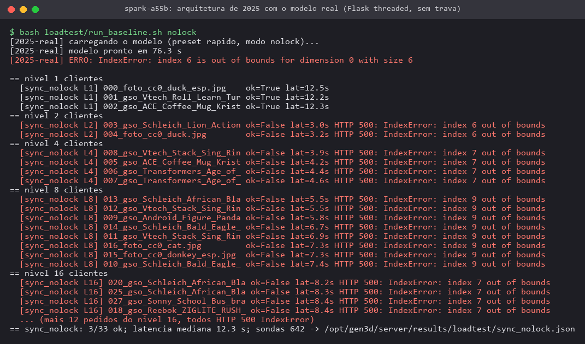

**Com trava global** todos os pedidos foram atendidos, mas as conexões ficam presas enquanto esperam a trava: com
16 clientes a latência p95 chegou a 210 s e o último cliente esperou 220 s com a conexão aberta — acima do tempo
limite usual de *proxies* e próximo do `readTimeout` de 5 min do app de 2025. Além disso, a responsividade do próprio
servidor degrada: `GET /` (página de *status*) tem p95 de 102–123 ms e p99 de 213–229 ms com a GPU ocupada, contra
3,9 ms de mediana, porque as *threads* do Flask competem pelo GIL com o processamento.

### 5.2 Comparação 2025 × 2026

**Tabela 1 — Resumo por configuração (33 jobs do preset rápido em rajadas de 1 a 16 clientes).**

| Configuração | Sucesso | Taxa de erro | Latência p50 | p95 | p99 | Vazão com 16 clientes | Pico de GPU do processo¹ | Menor `MemAvailable` |
|---|---|---|---|---|---|---|---|---|
| 2025, Flask síncrono, sem trava | 3/33 | 90,9 % | 12,3 s² | 12,5 s² | 12,5 s² | 0 jobs/min | 19,2 GB | 35,3 GB |
| 2025, Flask síncrono, com trava | 33/33 | 0 % | 52,1 s | 199,0 s | 215,7 s | 4,37 jobs/min | 18,2 GB | 29,8 GB |
| **2026, fila + 1 worker (produção)** | 33/33 | 0 % | 49,6 s | 174,1 s | 188,8 s | 4,99 jobs/min | 22,9 GB | 29,1 GB |
| 2026, fila + 2 slots (pesos compartilhados) | 33/33 | 0 % | 46,5 s | 155,6 s | 167,8 s | 5,63 jobs/min | 18,5 GB | 39,7 GB |

¹ `nvidia-smi` por processo (inclui o cache do alocador). O worker de produção carrega os três presets (o *paint*
completo do preset alto soma ~4,4 GB); o baseline de 2025 e o de 2 *slots* carregam só rápido (e padrão).
² Só os 3 pedidos do nível de 1 cliente tiveram sucesso.

**Tabela 2 — Rajada de 16 clientes simultâneos (o caso mais exigente).**

| Configuração | Latência p50 | p95 | máx. | Espera na fila p50 | p95 | Execução na GPU p50 | Vazão |
|---|---|---|---|---|---|---|---|
| 2025, com trava | 113,2 s | 210,2 s | 219,8 s | — (conexão presa) | — | — | 4,37 jobs/min |
| 2026, 1 worker | 102,9 s | 184,1 s | 192,3 s | 90,7 s | 171,5 s | 11,9 s | 4,99 jobs/min |
| 2026, 2 slots | 91,8 s | 164,4 s | 170,4 s | 70,5 s | 142,3 s | 21,0 s | 5,63 jobs/min |

**Tabela 3 — Responsividade da API com a GPU ocupada (sondas durante as rajadas).**

| Configuração | Rota | Amostras | p50 | p95 | p99 | máx. | Erros |
|---|---|---|---|---|---|---|---|
| 2025, sem trava | `GET /` (Flask) | 642 | 3,9 ms | 102,4 ms | 213,0 ms | 433,1 ms | 0 |
| 2025, com trava | `GET /` (Flask) | 4346 | 3,9 ms | 123,4 ms | 228,6 ms | 551,9 ms | 0 |
| 2026, 1 worker | `GET /api/v1/health` | 2012 | 3,7 ms | 6,6 ms | 8,3 ms | 38,3 ms | 0 |
| 2026, 1 worker | `GET /api/v1/jobs/{id}` | 2004 | 3,8 ms | 6,7 ms | 8,6 ms | 35,5 ms | 0 |
| 2026, 2 slots | `GET /api/v1/health` | 1818 | 4,1 ms | 6,6 ms | 9,2 ms | 26,2 ms | 0 |
| 2026, 2 slots | `GET /api/v1/jobs/{id}` | 1808 | 4,1 ms | 6,7 ms | 9,0 ms | 12,2 ms | 0 |
| 2026, 1 worker, *polling* ~50 req/s | `/health` · `/jobs/{id}` | 9569 | — | 6,0 · 6,1 ms | 8,2 · 7,8 ms | — | 0 |

As Figuras 5 a 8 resumem a comparação. Os principais resultados são:

* **Confiabilidade**: a taxa de erro caiu de 90,9 % (arquitetura de 2025 com o modelo real) para **0 %** em todas as
  configurações novas, porque a GPU passa a ser acessada por um único consumidor (ou por *slots* com travas por
  componente).
* **Latência e vazão**: com 16 clientes, a fila com 1 worker reduziu a latência p95 de 210,2 s para 184,1 s (−12 %)
  e elevou a vazão de 4,37 para 4,99 jobs/min (+14 %) em relação à versão síncrona com trava; com 2 *slots* a p95
  caiu para 164,4 s (−22 %) e a vazão subiu para 5,63 jobs/min (+29 % sobre 2025 e +13 % sobre 1 worker). O ganho
  de vazão é limitado porque **o gargalo é a própria GPU**: com 2 *slots* cada job leva ~21 s em vez de ~12 s (as
  etapas de decodificação e *delight* disputam o mesmo hardware; a espera nas travas foi de apenas 0,05–0,2 s em
  média), de modo que dois jobs em paralelo rendem só ~13 % a mais. Uma única GPU GB10 compartilhada sustenta
  ~5 jobs/min no preset rápido; acima disso a fila cresce linearmente.
* **Responsividade**: a API nova respondeu a `/health` e `/jobs/{id}` com p95 de 6,6–6,7 ms e p99 ≤ 9,2 ms com a
  GPU ocupada — **15–19 vezes menor** que o p95 do Flask (102–123 ms) e 23–27 vezes menor no p99 —, inclusive com
  *polling* intenso de ~50 req/s. O cliente recebe `202` em milissegundos, acompanha posição, ETA e etapa, e não
  precisa manter conexão aberta.
* **Memória**: o worker de produção ocupa ~15,8 GB alocados após carregar os três presets; o pico por job é
  ~18,9 GB alocados (22,9 GB do processo no `nvidia-smi`, incluindo o cache do alocador), sempre abaixo do teto de
  24 GB, e a memória disponível do host nunca ficou abaixo de 29 GB durante os testes (folga mínima exigida: 10 GB).

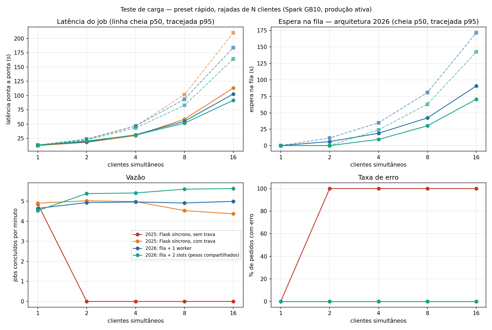

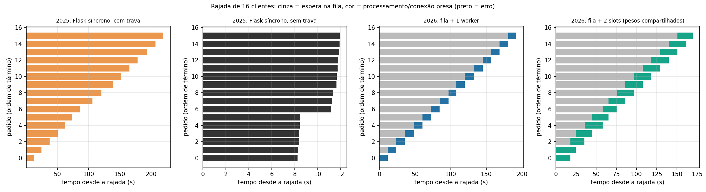

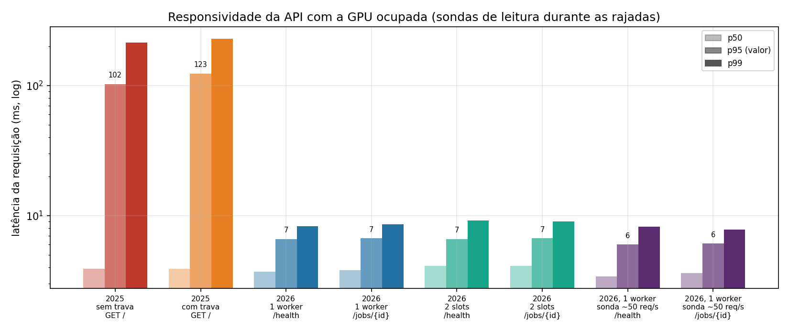

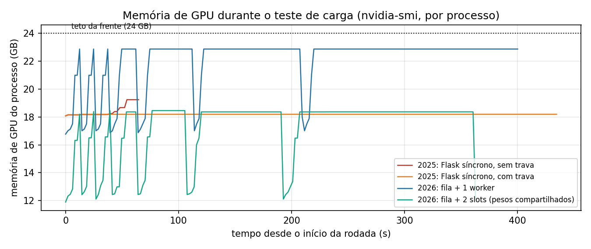

### 5.3 Cache, coalescência, prioridade e *backpressure*

**Tabela 4 — Cenários adicionais (1 worker).**

| Cenário | Pedidos | Atendidos | Execuções de GPU | Latência p50 | p95 / máx. | Observação |
|---|---|---|---|---|---|---|
| Reenvio de imagens já processadas (cache) | 10 | 10 | 0 | 0,02 s | 0,02 s | contra 13,3 s processando com a fila vazia |
| 8 clientes, mesma imagem nova ao mesmo tempo | 8 | 8 | **1** | 12,31 s | 12,32 s | 1 líder + 7 seguidores (coalescência) |
| Misto, prioridade por preset | 16 (12 rápido, 4 padrão) | 16 | 16 | 96,1 s | 140,9 / 144,0 s | rápido: fila p50 53,4 s; padrão: 111,5 s |
| Misto, FIFO pura | 16 (12 rápido, 4 padrão) | 16 | 16 | 99,7 s | 114,1 / 114,8 s | rápido: fila p50 87,6 s; padrão: 63,6 s |
| 16 clientes, fila máxima 8 | 16 | 9 | 9 | 60,6 s | 103,6 / 108,9 s | 7 recusados com 429 em 0,32 s (mediana) |

* **Cache e coalescência** eliminam trabalho redundante: um reenvio (por exemplo, nova tentativa do app após perder
  a conexão) é respondido em 0,02 s sem usar a GPU, e oito pedidos idênticos simultâneos custam uma única execução
  (Figura 9). A chave do cache inclui a versão do pipeline, o que permite invalidá-lo quando a saída muda (feito em
  26/10, ver Seção 6).
* **Prioridade por preset** (Figura 10): no mesmo cenário (8 clientes × 2 jobs, sorteio com semente 7, que gerou 12
  jobs rápidos e 4 padrão e nenhum alto), a prioridade reduziu a latência mediana dos jobs rápidos de 99,7 s para
  66,0 s (−34 %), ao custo de aumentar a dos jobs padrão de 85,1 s para 131,9 s; a latência média geral variou pouco
  (86,0 → 82,9 s) e o tempo total da rodada foi o mesmo (218 × 216 s). A espera máxima de um job padrão aumentou
  29,9 s (98,3 → 128,2 s), dentro do limite de envelhecimento de 30 s configurado — sem inanição. O ganho é de
  experiência: quem pede o modelo rápido não espera atrás de jobs mais pesados.
* ***Backpressure*** (Figura 11): com fila máxima 8, numa rajada de 16 clientes os 9 primeiros foram aceitos e os 7
  excedentes receberam **429 com `Retry-After` em 0,32 s**, em vez de esperar até 192 s como na configuração com
  fila máxima 32; o último job aceito terminou em 109 s. O limite transforma uma espera longa e incerta numa resposta
  imediata que o app pode exibir ("servidor ocupado, tente em instantes"), e protege a memória e o disco do host
  compartilhado.

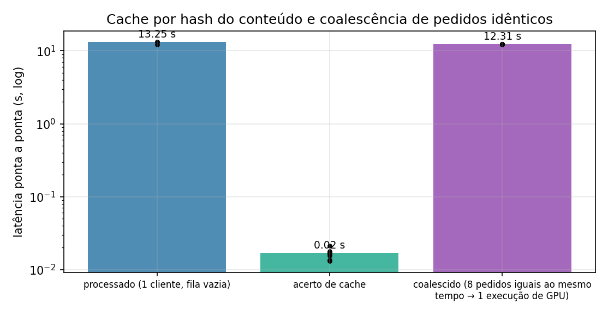

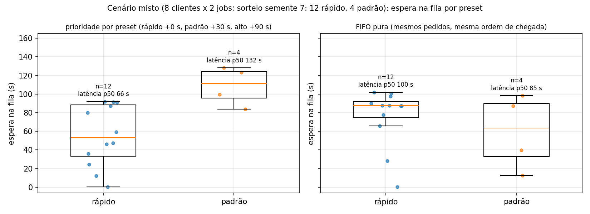

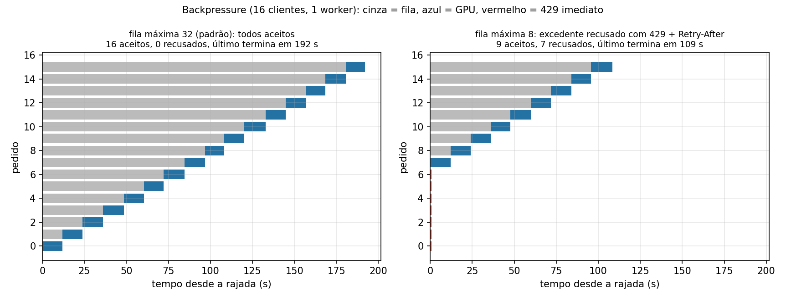

## 6. Lado servidor da Atividade 2: integração do modelo e teste ponta a ponta

O modelo selecionado na seção de geração 3D foi integrado ao servidor pelo motor `cerise_gen3d_server/engine.py`,
que usa o `Gen3DPipeline` carregado uma vez, reporta progresso por etapa (remoção de fundo, geometria, malha,
*delight*, UV, texturização multivista, *bake*, preparação para o celular, miniatura), honra as opções `texture` e
`remove_background` e gera o GLB no formato exigido pelo app: Y para cima, apoiado em y = 0, centralizado, maior
dimensão 0,30 m, textura JPEG e sem Draco/meshopt/KTX2.

O teste ponta a ponta foi feito **a partir do notebook Windows**, pelo encaminhamento local de SSH preso ao
loopback (`ssh -N -L 127.0.0.1:18095:localhost:8095 spark-bridge`; nada foi exposto à internet), com o script
`server/scripts/e2e_windows.py` e uma foto real CC0 (estatueta de galo do The Met, via Wikimedia Commons,
`validation/real/cc0_rooster.jpg`, 1280 px, 231 kB) no preset padrão (Figuras 12 e 13):

* `202` imediato, job iniciado em 0,27 s, progresso por etapa visível no *polling*, **GLB pronto em 16,1 s**
  (15,3 s de GPU), download do GLB (0,72 MB) em 0,33 s e da miniatura em 0,10 s pelo túnel;
* reenvio da mesma foto: acerto de cache em 155 ms (medido no Windows, incluindo o túnel SSH);
* **endpoint legado de 2025** (`POST /` com `front` + `metadata`): `200 model/gltf-binary`,
  `filename="objeto_ajustado.glb"`, 0,44 MB em 12,0 s — o app de 2025 passa a receber um modelo gerado de verdade
  sem nenhuma mudança no cliente;
* erros de validação com mensagens em português: texto no lugar da foto → 400; preset inválido → 400; job
  inexistente → 404.

Os GLBs baixados foram verificados de três formas (Figura 14): pela leitura do próprio binário no Windows
(`scripts/glb_check.py`: glTF 2.0, 20 000 triângulos no padrão e 10 000 no legado, textura JPEG 1024 × 1024, caixa no
mundo com maior dimensão 0,300 m, y mínimo 0,000 e centro em x/z = 0); pelo **Khronos glTF-Validator** (0 erros,
0 avisos, 0 infos); e pelo carregamento no **`<model-viewer>`** e no **three.js** em Chromium *headless* (ambos OK,
sem erros no console). Um segundo teste, já na versão final implantada (preset rápido, outra foto CC0), gerou o GLB
em 12,6 s (0,37 MB, textura JPEG) e o endpoint legado com a mesma foto foi respondido pelo cache em 0,2 s.

**Defeito encontrado e corrigido no teste ponta a ponta.** Na primeira execução o GLB do preset padrão tinha
2,97 MB e textura **PNG**, embora o pipeline declarasse "textura JPEG". A causa: o pós-processamento chamava
`gltf-transform jpeg` sem `--formats`, e na glTF-Transform 4.5 o padrão é `--formats jpeg` — só texturas que já são
JPEG são recomprimidas, então a textura PNG gerada pelo Hunyuan3D passava intacta (o `--verbose` registra
"Skipping, image/png excluded by formats parameter"). O motor do servidor passou a usar `--formats "*"`, a fonte
`pipeline/postprocess.py` foi corrigida e a versão do pipeline na chave do cache foi trocada para não servir GLBs
antigos. Para a mesma foto e a mesma geometria, o GLB caiu de **2,97 MB para 0,72 MB (−76 %)** no preset padrão e
de 2,60 MB para 0,44 MB (−83 %) no endpoint legado (preset rápido), sem diferença mensurável no tempo de geração
(15,22 s → 15,26 s). Verificou-se também que os GLBs das medições anteriores da seção de geração 3D (presets A3/A4)
têm textura PNG (`server/resultados/e2e/glb_check_presets_anteriores.txt`); a errata foi registrada naquela seção.

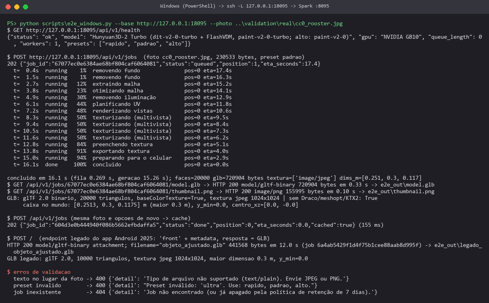

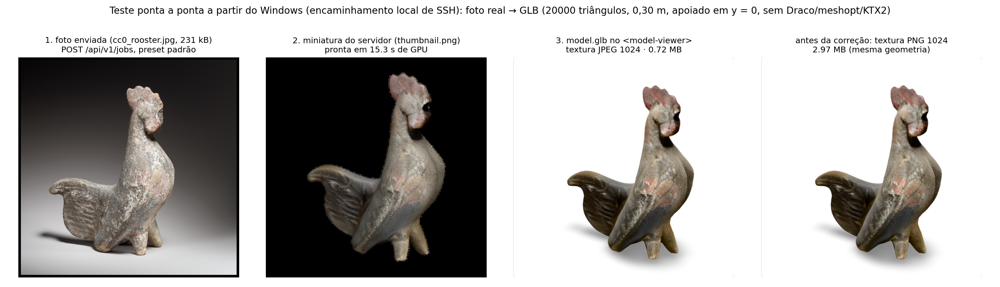

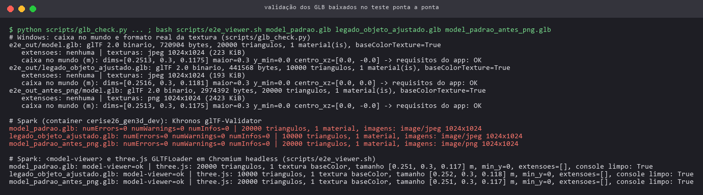

Os 18 testes automatizados do servidor (motor simulado, sem GPU) cobrem contrato da API, validação de entrada,
remoção de EXIF/GPS, cache, coalescência, prioridade, 429 por fila cheia e por cliente, cancelamento e exclusão,
erro do motor, opção sem textura, retomada após reinício, retenção de 7 dias e expiração na fila, endpoint legado,
métricas e documentação; todos passaram com o código final (Figura 15).

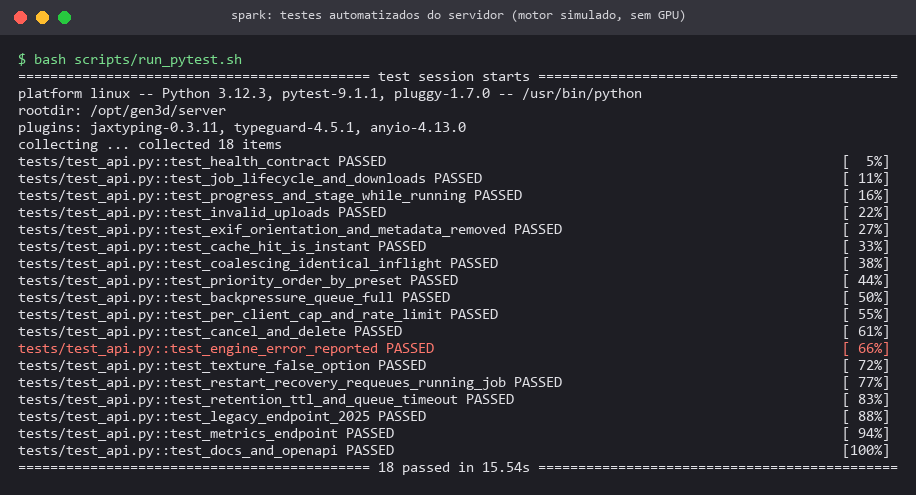

## 7. Operação, confiabilidade e estado do serviço

* **Estado em 26/10/2026 (~10:00)**: API e worker no ar no Spark (Figura 16), 1 *slot*, presets rápido, padrão e
  alto, `/health` = `ok`, porta somente no loopback (`127.0.0.1:8095`). Iniciar: `bash scripts/start.sh`; parar:
  `bash scripts/stop.sh` (parada graciosa — o worker termina o job em andamento e a fila permanece no SQLite);
  estado: `bash scripts/status.sh`; reimplantar após mudança de código: `bash scripts/redeploy.sh`.
* **Reinício do Spark**: na manhã de 26/10 o Spark foi desligado duas vezes sem aviso. Os contêineres voltaram
  sozinhos (`restart: unless-stopped`), mas na primeira vez o worker entrou em *loop* de reinício porque o desligamento
  abrupto corrompeu o índice do cache do numba (usado pelo `pymatting`, dependência do `rembg`), gravado em
  `dist-packages/__pycache__` dentro do contêiner. A correção imediata foi recriar os contêineres
  (`docker compose up -d --force-recreate`); a correção definitiva foi apontar `NUMBA_CACHE_DIR` para um `tmpfs`
  (`/tmp/numba_cache`) no `compose.yaml`, de modo que o cache é recriado limpo a cada início. A fila, por estar em
  SQLite com WAL, sobrevive a esses reinícios e o worker devolve à fila o job que estava em execução.
* **Convivência com a produção**: durante todos os testes e implantações os serviços de produção do Spark (vLLM,
  Qdrant) permaneceram ativos; nenhuma porta, contêiner ou configuração da produção foi alterada.
* **Exposição pública**: **não realizada** (decisão pendente do Eduardo). O `server/README.md` contém uma proposta
  com três opções (VPN entre o servidor público e o Spark, recomendada; túnel SSH reverso; túnel de terceiros), os
  riscos de cada uma, o endurecimento necessário (TLS no Caddy, chave de API, `X-Forwarded-For` sobrescrito pelo
  *proxy*, limites, bloqueio de `/metrics` e `/docs`, tempos limite) e os passos de implantação.

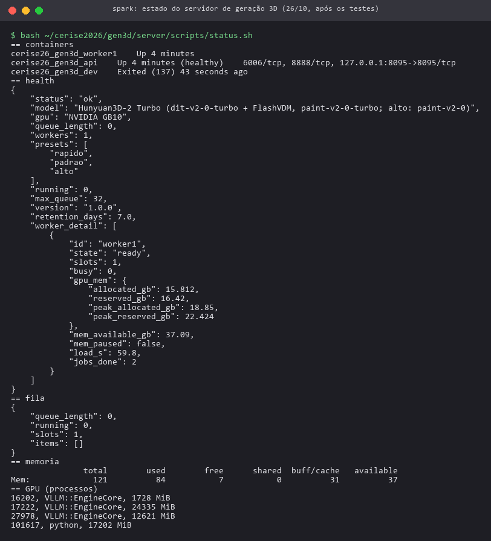

## 8. Escalabilidade: capacidade atual e caminhos

Com uma GPU GB10 compartilhada, a capacidade sustentada medida é de ~5 jobs/min no preset rápido (~12 s por job);
para o preset padrão (~15,5 s por job) a estimativa correspondente é de ~3,9 jobs/min. A latência cresce
linearmente com a fila (≈ 12 s por job rápido à frente). Pelos níveis medidos (p95 de 46,7 s com 4 clientes e de
93,5 s com 8), um objetivo de latência p95 de 1 min comporta rajadas de ~4–5 pedidos rápidos simultâneos; acima
disso o *backpressure* e a ETA informam o usuário. A arquitetura foi preparada para crescer sem mudar o contrato da API:

* **Mais GPUs**: cada worker é um processo independente que disputa a fila com *claim* atômico; numa GPU dedicada
  basta duplicar o serviço `worker` no `compose.yaml`. Com várias máquinas, o SQLite deve ser trocado por um banco
  em rede (PostgreSQL com `SELECT … FOR UPDATE SKIP LOCKED`) ou Redis, e os arquivos por armazenamento de objetos.
* **Mais *slots* na mesma GPU**: medido aqui, rende +13 % de vazão com 2 *slots*; útil quando a GPU tem folga, mas
  não substitui hardware adicional.
* **Redução do trabalho**: cache e coalescência já evitam repetições; o preset rápido como padrão do app e GLBs
  menores (JPEG de fato) reduzem também o tempo de transferência.
* **Observabilidade**: `/metrics` já expõe contadores e histogramas (jobs por status/preset, espera, duração, fila,
  rejeições); falta ligar um Prometheus/Grafana com alertas.

## 9. Repositório e reprodutibilidade

Código em <https://github.com/EduardoCaixeta/cerise-2026-gen3d>, pasta `server/`: `cerise_gen3d_server/` (API,
worker, motor, banco, métricas, gerência), `baseline_2025/` (reprodução medida do servidor de 2025), `loadtest/`
(cliente de carga, amostrador de GPU, suítes e análise), `tests/` (18 testes), `scripts/` (iniciar, parar, estado,
reimplantar, teste ponta a ponta, conferência de GLB, captura do Swagger), `compose.yaml`, `gen3d.env`, `Dockerfile`.
Dados medidos em `server/resultados/` (carga, tabelas, ponta a ponta, pytest). Não versionados: banco e arquivos de
jobs (`data/`), modelo do `rembg` (`models/u2net/u2net.onnx`, 176 MB) e GLBs.

## 10. Limitações e próximos passos

* **Máquina compartilhada**: todos os tempos foram medidos com a produção de IA ativa na mesma GPU; as
  configurações foram medidas em sequência, em horários próximos, mas não simultâneos (variação de fundo não
  controlada). Repetir a suíte numa janela ociosa daria valores de referência.
* **Cliente no próprio Spark**: os testes de carga excluem a rede; a latência real do app somará upload e download
  pela internet (no túnel SSH do teste ponta a ponta o GLB de 0,72 MB levou 0,33 s).
* **Cenário misto sem preset alto**: o sorteio usado não gerou jobs do preset alto; o efeito da prioridade sobre
  jobs longos (deslocamento de 90 s) não foi medido sob carga.
* **2 *slots* com conjunto de presets diferente** (sem o alto) por causa do teto de 24 GB; a memória medida não é
  diretamente comparável à configuração de produção.
* **Baseline de 2025**: o `sleep(67)` original não exercita a GPU; a comparação usa a reprodução da arquitetura de
  2025 com o modelo real, que é a hipótese relevante (o que aconteceria se o modelo fosse ligado àquele servidor).
* **Pendências que dependem do Eduardo**: (1) decidir a exposição pública (proposta no `server/README.md`); até lá o
  acesso é só por `ssh -L`; (2) se exposto, definir a chave de API (`GEN3D_API_KEYS`, arquivo fora do git) e
  publicar a versão do app que a envia.
* **Próximos passos técnicos**: refazer a rodada de presets da seção de geração 3D com a textura JPEG corrigida
  (tamanhos de GLB) e reconstruir a imagem `cerise26_gen3d:latest` com o `postprocess.py` corrigido; ligar
  Prometheus/Grafana às métricas; testar o app de 2026 no emulador (`http://10.0.2.2:18095`) e em celular pela rota
  pública quando aprovada.
