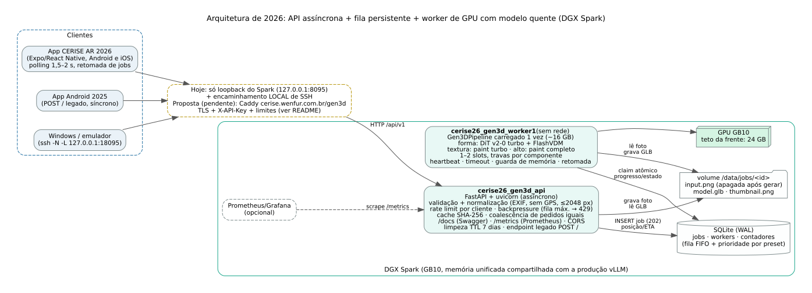

# Servidor de geração 3D do CERISE (API + fila + worker de GPU)

Servidor que recebe a foto de um objeto e devolve um modelo **GLB texturizado** para o app CERISE AR
(Objetivo 2 · Atividade 5 do Plano de Trabalho 2026 e lado servidor da Atividade 2). Substitui o `server.py` de 2025
(Flask de desenvolvimento, `time.sleep(67)` e um GLB fixo) por uma arquitetura **assíncrona**: API FastAPI, fila
persistente em SQLite e um worker de GPU com o modelo **Hunyuan3D-2 Turbo** sempre carregado (pacote
`Gen3DPipeline` da pasta `../pipeline`, escolhido e otimizado na frente de modelos).



Resultados do teste de carga, teste ponta a ponta e análise dos gargalos: [`../RELATORIO_SECAO_SERVIDOR.md`](../RELATORIO_SECAO_SERVIDOR.md)
(tabelas em `resultados/tabelas/`, dados brutos em `resultados/loadtest/` e `resultados/e2e/`, figuras em
`../evidencias/srv_*.png` e `../evidencias/swagger_*.png`).

## Estado atual (26/10/2026, ~10:00)

* Rodando no DGX Spark: containers `cerise26_gen3d_api` (porta **127.0.0.1:8095**, só loopback) e
  `cerise26_gen3d_worker1` (1 slot, presets `rapido`, `padrao`, `alto`), `restart: unless-stopped`, imagem
  `cerise26_gen3d_server:latest` reconstruída com o código deste repositório (18/18 testes aprovados).
* **Sem acesso pela internet.** Para testar de outro computador, usar o encaminhamento LOCAL de SSH (abaixo).
  A exposição pública em `https://cerise.wenfur.com.br/gen3d` é decisão pendente do bolsista (proposta no fim).
* Correções feitas no fechamento (26/10): (1) a textura do GLB passou a ser **JPEG de fato** — o
  `gltf-transform jpeg` 4.5 só recomprime texturas que já são JPEG (`--formats jpeg` é o padrão), então a textura
  PNG do Hunyuan3D passava intacta; agora o motor usa `--formats "*"` (GLB do preset padrão no teste ponta a ponta:
  2,97 MB → 0,72 MB, sem mudança de geometria nem de tempo) e a versão do pipeline na chave do cache foi trocada
  (`hy2turbo-a3-v2-jpeg`) para não servir GLBs antigos; (2) o cache do numba (pymatting/rembg) foi para um `tmpfs`
  (`NUMBA_CACHE_DIR=/tmp/numba_cache`): um desligamento abrupto do Spark corrompeu o cache gravado em
  `dist-packages/__pycache__` e o worker entrou em loop de reinício.

## Contrato da API (`/api/v1`)

| Método e rota | Descrição |
|---|---|
| `GET /api/v1/health` | `{"status","model","gpu","queue_length","workers","presets"}` (+ `running`, `max_queue`, `worker_detail`) |
| `POST /api/v1/jobs` | multipart: `image` (JPEG/PNG ≤ 15 MB) + `options` JSON opcional `{"preset":"rapido\|padrao\|alto","texture":true,"remove_background":true}` → `202 {"job_id","status":"queued","position","eta_seconds"}`; acerto de cache → `202` com `"status":"done"`; `400` imagem/opções inválidas; `413` > 15 MB; `429` fila cheia, limite por cliente ou rate limit (com `Retry-After`) |
| `GET /api/v1/jobs/{id}` | `{"job_id","status":"queued\|running\|done\|error\|cancelled","progress","stage","position","eta_seconds","error","result":{"glb_url","thumbnail_url","stats"}}` (URLs relativas à base) |
| `GET /api/v1/jobs/{id}/model.glb` | `model/gltf-binary` (409 se ainda não pronto) |
| `GET /api/v1/jobs/{id}/thumbnail.png` | miniatura PNG |
| `DELETE /api/v1/jobs/{id}` | na fila → `{"status":"cancelled"}`; em execução → 409; já terminado → apaga foto/modelo do servidor (`{"status":"deleted"}`) |
| `GET /api/v1/queue` | resumo anônimo da fila (operação) |
| `GET /metrics` | métricas Prometheus |
| `GET /docs` | Swagger (OpenAPI) |
| `POST /` | **legado** do app Android 2025: multipart com `front` (+ `left/back/right`) e `metadata`; responde o GLB de forma síncrona (`objeto_ajustado.glb`) |

O GLB entregue segue o requisito do app: Y para cima, apoiado em y = 0, centralizado, maior dimensão 0,30 m, textura
JPEG qualidade 85 (1024 px em `rapido`/`padrao`, 2048 px em `alto`) e **sem Draco/meshopt/KTX2**. Conferido no
teste ponta a ponta com o Khronos glTF-Validator (0 erros, 0 avisos), no `<model-viewer>` e no three.js
(`scripts/glb_check.py` e `scripts/e2e_viewer.sh`). O campo `result.stats.texture_mime` informa o formato da textura.

## Como iniciar, parar e acompanhar (no Spark)

```bash
cd ~/cerise2026/gen3d/server
bash scripts/start.sh            # constrói a imagem se faltar, confere a memória, sobe API + worker e espera o modelo
bash scripts/status.sh           # containers, /health, fila, memória e GPU por processo
bash scripts/stop.sh             # parada graciosa (o worker termina o job em andamento; a fila fica no SQLite)
sudo docker logs -f cerise26_gen3d_worker1     # logs estruturados (JSON por linha)
touch data/PAUSE / rm data/PAUSE  # drena a GPU sem derrubar a API (ex.: produção precisando de memória)
bash scripts/smoke.sh <foto.jpg> rapido        # teste rápido local
bash scripts/redeploy.sh         # depois de mudar o código: reconstrói a imagem e recria API + worker (1 slot)
bash scripts/run_pytest.sh       # 18 testes automatizados com o código atual montado (sem GPU)
```

Equivalente direto: `sudo docker compose -f compose.yaml up -d` / `down`. `bash scripts/start.sh 2` sobe o worker com
2 slots (dois jobs simultâneos no mesmo processo, pesos compartilhados). Carga do worker: ~60–135 s para carregar os
pesos + ~40 s de aquecimento (`rapido` e `alto`); depois disso ocupa ~15,8 GB alocados (~16,4 GB reservados) e o pico
de um job é ~18,8 GB (teto da frente no Spark: 24 GB). Os containers voltam sozinhos depois de um reboot do Spark
(`restart: unless-stopped`; verificado no religamento de 26/10).

**Se o worker entrar em loop de reinício** (ex.: depois de um desligamento abrupto): ver `sudo docker logs --tail 50
cerise26_gen3d_worker1`; a correção é recriar os containers —
`sudo GEN3D_WORKER_SLOTS=1 GEN3D_TRUST_PROXY=0 docker compose -f compose.yaml up -d --force-recreate` (ou
`bash scripts/redeploy.sh`). Com o cache do numba em `tmpfs` o caso conhecido (índice do cache corrompido) não se
repete, porque o cache é recriado limpo a cada start.

## Teste a partir do Windows (encaminhamento local, nada exposto)

```powershell
ssh -N -L 127.0.0.1:18095:localhost:8095 spark-bridge      # deixar aberto (Ctrl+C fecha); escuta só no loopback
curl http://127.0.0.1:18095/api/v1/health
python scripts\e2e_windows.py --base http://127.0.0.1:18095 --photo ..\validation\real\cc0_rooster.jpg --out e2e_out
python scripts\glb_check.py e2e_out\model.glb               # caixa no mundo (m), formato real da textura, extensões
```

O `e2e_windows.py` faz: health → envio da foto → acompanhamento da fila/progresso → download do GLB e da miniatura →
conferência do GLB → reenvio (acerto de cache) → endpoint legado de 2025 → erros de validação. Para conferir o GLB
com o glTF-Validator e no `<model-viewer>`/three.js (Chromium headless no Spark): copiar os GLBs para
`results/e2e/` no Spark e rodar `bash scripts/e2e_viewer.sh <arquivos>`.

No emulador Android a mesma porta aparece como `http://10.0.2.2:18095` (configurar no app em Configurações → URL do
servidor). Swagger: `http://127.0.0.1:18095/docs`.

## Estrutura

| caminho | conteúdo |
|---|---|
| `cerise_gen3d_server/api.py` | FastAPI: validação, normalização da foto, cache, coalescência, backpressure, rate limit, CORS, /metrics, legado |
| `cerise_gen3d_server/worker.py` | worker de GPU: claim atômico, slots, heartbeat, timeout, guarda de memória, retomada após restart, pausa |
| `cerise_gen3d_server/engine.py` | motor sobre o `Gen3DPipeline` (progresso por etapa, `texture`/`remove_background`, travas por componente) e motor simulado para testes |
| `cerise_gen3d_server/db.py` | SQLite (WAL): jobs, workers, contadores/histogramas, plano da fila (posição/ETA) |
| `cerise_gen3d_server/manage.py` | `stats`, `cleanup`, `purge --yes`, `export-jobs` |
| `baseline_2025/server_2025_real.py` | reprodução medida do servidor de 2025 com o modelo real (Flask síncrono, modos `nolock`/`lock`) |
| `loadtest/` | cliente de carga asyncio/httpx, pool de imagens, amostrador de GPU, suítes e análise (`analyze.py`) |
| `tests/test_api.py` | 18 testes automatizados (pytest) com motor simulado: contrato, validação, cache, prioridade, 429, cancelamento, retomada, TTL, legado, métricas |
| `scripts/` | `start.sh`, `stop.sh`, `status.sh`, `redeploy.sh`, `wait_health.sh`, `smoke.sh`, `run_pytest.sh`, `e2e_windows.py`, `glb_check.py`, `e2e_viewer.sh`, `shot_docs.js` |
| `compose.yaml`, `gen3d.env`, `Dockerfile` | implantação (imagem `cerise26_gen3d_server:latest`, derivada de `cerise26_gen3d:latest`) |
| `resultados/` | dados medidos (JSON/CSV) e tabelas |

## Decisões de projeto

* **API separada do worker.** A API nunca toca na GPU: responde em milissegundos mesmo com a GPU ocupada e pode ser
  reiniciada sem descarregar o modelo. O worker roda **sem rede** (`network_mode: none`) e só lê/escreve o volume.
* **SQLite (WAL) em vez de Redis.** Um único host, poucos jobs por minuto (a GPU conclui ~5 jobs/min no preset
  rápido), necessidade de durabilidade e de consultas ricas (posição, cache por hash, TTL, métricas) sem operar mais um
  serviço. `UPDATE … RETURNING` dentro de `BEGIN IMMEDIATE` faz o *claim* atômico entre processos. Redis só passaria a
  valer com várias máquinas de GPU.
* **Fila FIFO com prioridade por preset e envelhecimento.** `score = criado_em + deslocamento` (rápido +0 s, padrão
  +30 s, alto +90 s): um job leve passa à frente de um pesado recém-chegado, mas nenhum job espera mais que o deslocamento
  além do que esperaria numa FIFO pura (sem inanição).
* **Backpressure e limites.** Fila máxima (`GEN3D_MAX_QUEUE=32`) → 429; no máximo 4 pedidos em andamento por cliente;
  rate limit por cliente (6 envios/min, rajada 6; 1200 leituras/min); limite de 15 MB pelo `Content-Length` antes de
  ler o corpo; proteção contra *decompression bomb* (50 MP); `--limit-concurrency 512` no uvicorn.
* **Cache por hash do conteúdo** (SHA-256 da imagem + opções + versão do pipeline): mesma foto e opções → resposta
  imediata sem GPU. Pedidos idênticos **em andamento** são coalescidos (o mesmo cliente recebe o mesmo job; outro
  cliente vira "seguidor" e recebe o resultado do líder).
* **Privacidade (LGPD / política do app).** A foto é normalizada (orientação EXIF aplicada, **metadados e GPS
  removidos**), apagada logo após o processamento, e jobs/modelos são apagados em **7 dias** (`GEN3D_RETENTION_DAYS`).
  O IP do cliente não é gravado (só um hash truncado). `DELETE` num job terminado apaga os dados na hora.
* **Robustez.** Jobs sobrevivem a restart (estão no SQLite); ao iniciar, o worker devolve à fila o que estava rodando
  nele; a API devolve à fila jobs de workers sem *heartbeat*; até 2 tentativas; timeout por preset (240/300/600 s) com
  reinício do worker pelo Docker; erro de memória de GPU volta para a fila; jobs esquecidos na fila por mais de 1 h viram
  erro explícito.
* **Convivência com a produção do Spark.** O worker limita o alocador a 24 GB, só carrega o modelo com folga de
  memória (`MemAvailable ≥ 10 GB` além do modelo), só pega job novo se sobrar a folga, devolve o cache do alocador
  quando fica ocioso e pode ser pausado com `data/PAUSE`.
* **Concorrência na GPU.** Dois processos de GPU (duas cópias dos pesos, ~2 × 18,8 GB de pico) passariam do teto de 24 GB
  desta frente; por isso a opção de 2 "workers" é implementada como **2 slots no mesmo processo** com pesos
  compartilhados. Os componentes com estado (difusão de forma + *scheduler*, decodificador FlashVDM, *delight*,
  difusão multivista de cada *paint*, renderizador da miniatura) têm travas próprias e cada slot tem o seu `MeshRender`,
  de modo que dois jobs ficam em etapas diferentes ao mesmo tempo. Sem essas travas, chamadas concorrentes ao mesmo
  modelo falham (medido: ver relatório, baseline "sem trava").

## Configuração (variáveis de ambiente, `gen3d.env`)

| variável | padrão | efeito |
|---|---|---|
| `GEN3D_MAX_QUEUE` | 32 | jobs na fila antes de responder 429 |
| `GEN3D_MAX_QUEUED_PER_CLIENT` | 4 | pedidos em andamento por cliente |
| `GEN3D_RATE_JOBS_PER_MIN` / `_BURST` | 6 / 6 | rate limit de envios por cliente |
| `GEN3D_RATE_READS_PER_MIN` / `_BURST` | 1200 / 200 | rate limit de leituras (polling) por cliente |
| `GEN3D_PRIORITY_OFFSETS` | `rapido:0,padrao:30,alto:90` | prioridade por preset (s) |
| `GEN3D_JOB_TIMEOUTS` | `rapido:240,padrao:300,alto:600` | timeout por preset (s) |
| `GEN3D_RETENTION_DAYS` | 7 | retenção de fotos/modelos |
| `GEN3D_CACHE` | 1 | cache por hash + coalescência |
| `GEN3D_WORKER_SLOTS` | 1 | jobs simultâneos no worker (1–2) |
| `GEN3D_WORKER_PRESETS` | `rapido,padrao,alto` | presets carregados (sem `alto` economiza ~4,4 GB) |
| `GEN3D_GPU_CAP_GB` / `GEN3D_MIN_AVAILABLE_GB` | 24 / 10 | teto do alocador / folga mínima do host |
| `GEN3D_TRUST_PROXY` | 0 | usar `X-Forwarded-For` (só atrás de proxy confiável) |
| `GEN3D_API_KEYS` | vazio | se definido, exige `X-API-Key` nas rotas `/api/` (colocar num arquivo fora do git) |
| `GEN3D_LEGACY_PRESET` / `GEN3D_LEGACY_TIMEOUT_S` | `rapido` / 290 | endpoint legado de 2025 |
| `GEN3D_CORS_ORIGINS` | `https://cerise.wenfur.com.br,…` | origens web permitidas |
| `GEN3D_PIPELINE_VERSION` | `hy2turbo-a3-v2-jpeg` | entra na chave do cache; **trocar sempre que a saída do pipeline mudar** |
| `NUMBA_CACHE_DIR` | `/tmp/numba_cache` (tmpfs do compose) | cache do numba fora do `dist-packages`, recriado limpo a cada start |

Arquivos que **não** vão para o git: `data/` (banco e jobs), `loadtest/pool/`, `results/` brutos e GLBs — estão no
pacote `gen3d_servidor_brutos.tar.gz` dos Releases (`../RELEASES.md`); `models/u2net/u2net.onnx` (modelo do rembg,
176 MB, copiado do container de desenvolvimento) é de terceiros (`../TERCEIROS.md`). Cópias em git dos registros
de `data/` (`jobs_q*.json` e `jobs/*/out/stats.json`) ficam em `resultados/data/`.

## Retenção de dados (7 dias) e privacidade

Prometido na política de privacidade do app (`cerise-expo/store/privacidade.html`) e implementado no servidor:

* a foto enviada é normalizada (EXIF aplicado; metadados e GPS removidos) e **apagada logo após o processamento**
  (`GEN3D_DELETE_INPUT_AFTER_PROCESSING=1`);
* uma rotina de limpeza na API (a cada `GEN3D_JANITOR_INTERVAL_S`) apaga do disco e do banco os jobs, modelos e
  miniaturas com mais de `GEN3D_RETENTION_DAYS` = **7 dias**; `python -m cerise_gen3d_server.manage cleanup` força a
  limpeza e `manage purge --yes` apaga tudo;
* `DELETE /api/v1/jobs/{id}` num job terminado apaga os dados na hora (direito de exclusão);
* o IP do cliente não é gravado (só um hash truncado, para o limite por cliente).

Coberto pelos testes `test_retention_ttl_and_queue_timeout`, `test_cancel_and_delete` e
`test_exif_orientation_and_metadata_removed`.

## Resultados principais (medidos no Spark, preset rápido, máquina compartilhada com a produção)

| configuração | sucesso | latência p50 / p95 (33 jobs) | rajada de 16: p95 | vazão (16) | API p95 com GPU ocupada |
|---|---|---|---|---|---|
| 2025, Flask síncrono, sem trava (modelo real) | 3/33 (91 % de erro) | — | 100 % de erro | 0 | 102 ms (`GET /`) |
| 2025, Flask síncrono, com trava global | 33/33 | 52,1 / 199,0 s | 210,2 s | 4,37 jobs/min | 123 ms (`GET /`) |
| **2026, fila + 1 worker (produção)** | 33/33 | 49,6 / 174,1 s | 184,1 s | 4,99 jobs/min | 6,6 ms (`/health`), 6,7 ms (`/jobs/{id}`) |
| 2026, fila + 2 slots (pesos compartilhados) | 33/33 | 46,5 / 155,6 s | 164,4 s | 5,63 jobs/min | 6,6 ms / 6,7 ms |

Cache por hash: 0,02 s (contra 13,3 s processando); 8 pedidos iguais simultâneos → 1 execução de GPU; fila máxima 8
com 16 clientes → 7 recusados com 429 em 0,32 s (mediana). Teste ponta a ponta do Windows (preset padrão, foto
real): 16,1 s até o GLB pronto, GLB de 0,72 MB. Detalhes e discussão em `../RELATORIO_SECAO_SERVIDOR.md`.

## Testes

```bash
# testes automatizados (motor simulado, sem GPU) — 18 testes, com o código atual montado só-leitura
bash scripts/run_pytest.sh
# baseline de 2025 e suíte de carga da arquitetura nova (precisam da GPU; ver loadtest/)
bash loadtest/run_baseline.sh lock ; bash loadtest/run_baseline.sh nolock
bash loadtest/run_suite_new.sh
python loadtest/analyze.py resultados/loadtest resultados/tabelas ../evidencias
```

## PROPOSTA de exposição pública (para decisão do bolsista — nada disto foi feito)

Objetivo: o app em produção usar `https://cerise.wenfur.com.br/gen3d` (URL padrão já configurada no app).

**Opções de caminho de rede**

| opção | como | prós | contras / riscos |
|---|---|---|---|
| **A. VPN entre o wenfur e o Spark (recomendada)** | WireGuard (ou a VPN institucional, se o wenfur já alcançar o Spark); Caddy do wenfur faz `reverse_proxy` para `IP_VPN_DO_SPARK:8095`; a API passa a escutar só na interface da VPN | tráfego cifrado, nenhuma porta pública no Spark, controle total | configurar VPN nos dois lados; depende da política de rede da UFG; precisa de acesso `wenfur-root` |
| B. Túnel SSH reverso Spark → wenfur (`autossh -R`) | o Spark abre um túnel para o loopback do wenfur | simples | **vedado pelas regras de uso do Spark até a decisão**; frágil (cai e precisa de supervisão); chave SSH do Spark com acesso ao servidor público |
| C. Cloudflare Tunnel / ngrok | agente no Spark publica o serviço | sem abrir portas | dados (fotos) passam por terceiro (LGPD), dependência externa; não recomendado |

**Endurecimento antes de expor (independe da opção)**

1. **TLS** pelo Caddy (automático) e só HTTPS.
2. **Autenticação por chave**: `GEN3D_API_KEYS` (arquivo `gen3d.secrets.env` fora do git) e o app enviando `X-API-Key`
   (mudança pequena no `src/gen3d/api.ts`). Como a chave fica no APK, ela serve para filtrar abuso, não como segredo
   forte; rotação por versão do app.
3. **Limites**: manter o rate limit da API com `GEN3D_TRUST_PROXY=1` (o Caddy deve **sobrescrever** o
   `X-Forwarded-For`), `request_body max_size 16MB` no Caddy, fila máxima 32 e 4 pedidos por cliente.
4. **Rotas**: publicar só `/gen3d/api/v1/*` (e `POST /gen3d/` se o app de 2025 ainda for usado); bloquear `/metrics`,
   `/docs` e `/openapi.json` publicamente (acessar pela VPN).
5. **Timeouts** do proxy: 60 s para envio; 320 s só para o legado `POST /`.
6. **Monitoramento**: Prometheus/Grafana lendo `/metrics` pela VPN; alerta de fila cheia, worker parado, erros.

Exemplo de rota no Caddy (proposta, **não aplicada**):

```caddy
cerise.wenfur.com.br {
    handle_path /gen3d/* {
        @interno path /metrics /docs /openapi.json
        respond @interno 404
        request_body {
            max_size 16MB
        }
        reverse_proxy 10.99.0.2:8095 {          # IP do Spark na VPN (exemplo)
            header_up X-Forwarded-For {remote_host}
            transport http {
                dial_timeout 5s
                response_header_timeout 320s
            }
        }
    }
}
```

`handle_path` remove o prefixo `/gen3d`; como as URLs de resultado são relativas (`/api/v1/jobs/<id>/model.glb`) e o
app as junta à base `https://cerise.wenfur.com.br/gen3d`, nada muda no servidor.

**Passos** (quando aprovado): (1) escolher a opção A e configurar a VPN; (2) no Spark, trocar em `compose.yaml` a porta
para `IP_VPN:8095:8095`, definir `GEN3D_TRUST_PROXY=1` e `GEN3D_API_KEYS` e recriar só a API; (3) no wenfur, backup do
Caddyfile, adicionar a rota, `caddy validate` e `caddy reload` (sem restart), conferir os outros sites; (4) publicar a
versão do app que envia `X-API-Key`; (5) acompanhar `/metrics` e ajustar os limites.

**Riscos que continuam**: abuso da GPU compartilhada com a produção (mitigado por fila máxima, rate limit, teto de
24 GB, guarda de memória e `data/PAUSE`); capacidade de ~5 jobs/min no preset rápido com 1 worker (fila e ETA
informam o usuário); vulnerabilidades em decodificadores de imagem (Pillow atualizado; o worker não tem rede).
